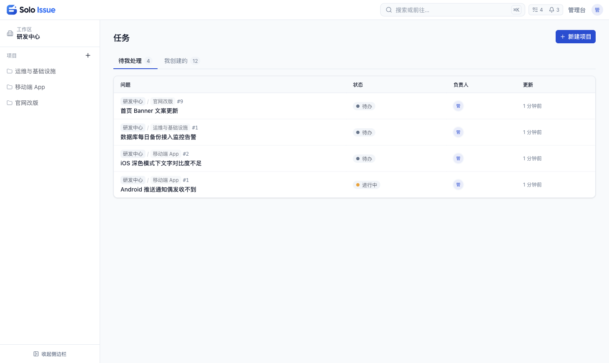
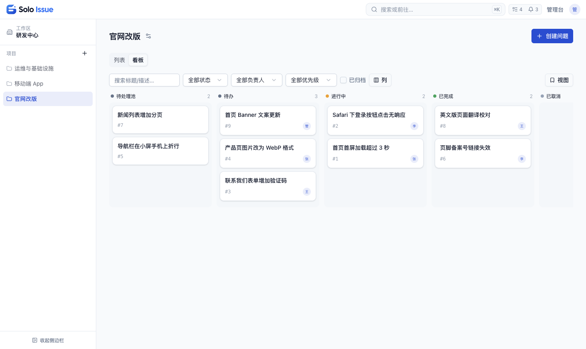
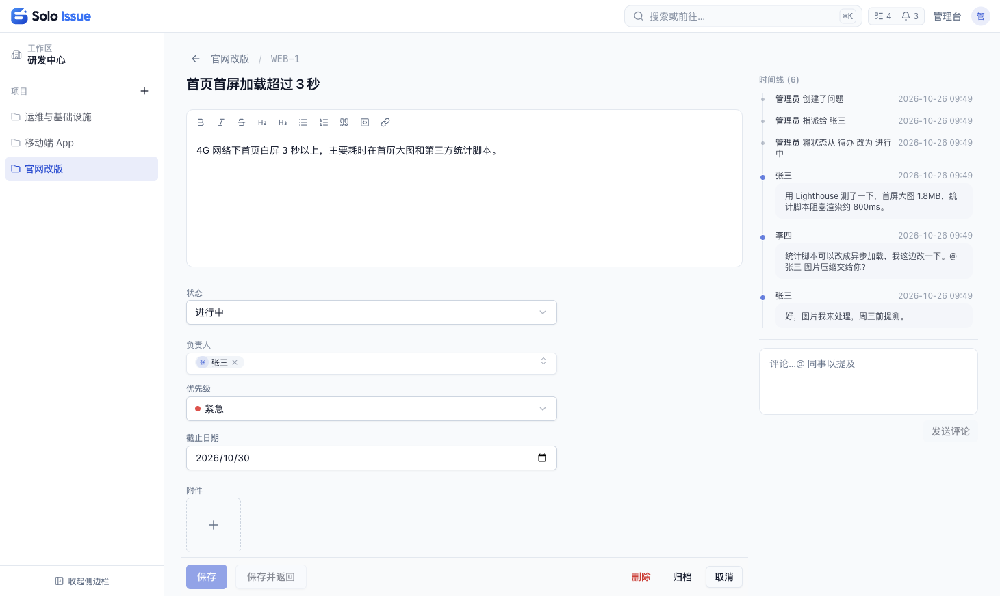

# Solo Issue


面向个人和小团队的自托管问题追踪工具：记录任务和 bug，指派负责人，跟踪到完成。

- **自托管**：部署在你自己的服务器或电脑上，数据只存在你自己的数据库里
- **企业微信集成**：可用企业微信身份登录，提醒推送到企业微信
- **AI 可接入**：提供 REST API 和 MCP 服务器
- **MIT 开源**，免费使用；当前为 0.0.2 内测版本

## 1. 适用场景

适合：

- 团队日常用企业微信沟通，希望群里提到的问题有记录、有负责人、可查进度
- 数据必须存放在自己的服务器上，不能使用第三方在线服务
- 觉得 Jira、禅道等工具过重，只需要"记问题、分负责人、跟状态"
- 个人开发者，在自己电脑上管理项目任务

不适合：需要迭代计划、路线图、甘特图或工时统计的团队，Solo Issue 不提供这些功能（产品边界见[架构与设计](docs/01-architecture.md) §2.2，设计取舍见 §7）。

## 2. 功能

| 功能 | 说明 |
|---|---|
| 固定编号与链接 | 每个问题有项目内编号和固定链接，描述、讨论、附件、处理进度集中在一个页面，贴到群里大家看到的是同一个问题 |
| 通知提醒 | 被指派、被 @、你负责或创建的问题状态变更、你参与的问题有新评论时，收到站内通知；接入企业微信后同步推送，可按提醒类型单独关闭 |
| 变更记录 | 状态、负责人、描述、自定义字段的每次修改及每条评论，都记录操作人和时间，显示在问题时间线中 |
| 自定义字段 | 在项目设置中添加优先级、严重程度、客户名称、截止日期等字段，支持文本、数字、日期、单选、多选、成员六种类型；单选、多选字段可用于筛选；字段配置可导出并导入其他项目 |
| 看板与列表 | 看板拖动卡片即可改状态；列表可按状态、负责人和字段筛选，并保存常用筛选条件；描述和评论支持富文本、粘贴图片和附件 |
| 权限控制 | 工作区成员分负责人、成员、访客三种角色，访客只读；项目可设为私有，仅项目成员和工作区负责人可见 |
| AI 助手接入 | Claude 等支持 MCP 的 AI 助手可查询、创建、更新问题和发表评论；AI 使用你签发的令牌访问，操作记在令牌所属账号名下，权限不超过该账号 |
| 部署简单 | 单机一条 `docker compose` 命令启动；只依赖 PostgreSQL，无需额外的缓存或消息队列；备份只需数据库和附件目录；界面支持中文和英文 |

注意事项：

- 企业微信推送的内容包含问题摘要和链接，会经过企业微信的服务器
- 需要保留历史的问题请使用"归档"；删除问题会连同其变更记录一起删除

## 3. 界面预览

### 工作区首页



### 项目看板



### 问题详情与编辑



## 4. 快速开始

### 4.1 前置条件

- 已安装 Docker 和 Docker Compose
- 8081 端口空闲（如被占用，可在 `apps/web/.env` 中修改 `APP_PORT`，并同步修改 `APP_URL` 中的端口）

### 4.2 下载并配置

```bash
git clone https://github.com/xesam/solo-issue.git solo-issue
cd solo-issue
cp apps/web/.env.example apps/web/.env
```

编辑 `apps/web/.env`，取消以下两行的注释并填入管理员账号（**必填**，不设置密码则无法用邮箱登录）：

```bash
ADMIN_EMAIL=admin@example.com
ADMIN_INIT_PASSWORD=change-me-on-first-login
```

可选：在国内网络环境下构建时，取消以下三行的注释以加快依赖下载：

```bash
DEBIAN_MIRROR=mirrors.huaweicloud.com
NPM_REGISTRY=https://registry.npmmirror.com
PRISMA_MIRROR=https://registry.npmmirror.com/-/binary/prisma
```

### 4.3 启动

```bash
docker compose --env-file apps/web/.env up --build -d
```

首次启动需要构建镜像，耗时取决于网络状况。

### 4.4 登录

打开 <http://localhost:8081/solo-issue>，使用上面设置的邮箱和密码登录，首次登录需按提示修改密码。

> **登录后被退回登录页？** 默认配置下会话 cookie 只在 HTTPS 或 localhost 下生效。通过服务器 IP 以 HTTP 访问（如 `http://192.168.x.x:8081`）时，需在 `apps/web/.env` 中加上 `ALLOW_INSECURE_COOKIES=1`，再重新执行启动命令。正式部署建议配置 HTTPS，不要开启此项。

## 5. 下一步

| 想做的事 | 文档 |
|---|---|
| 部署到服务器长期使用（HTTPS、备份、升级） | [docs/08-deployment.md](docs/08-deployment.md) |
| 接入企业微信，同事免注册登录并接收推送 | [docs/09-wecom-setup.md](docs/09-wecom-setup.md) |
| 了解架构与设计取舍，判断是否适合自己 | [docs/01-architecture.md](docs/01-architecture.md) |
| 接入 AI 助手（REST API / MCP） | [AGENTS.md](AGENTS.md)、[packages/mcp/README.md](packages/mcp/README.md) |
| 本地开发、参与贡献 | [docs/README.md](docs/README.md) |

## 6. 技术栈

| 层 | 选型 |
|---|---|
| 应用 | Next.js 15（App Router，页面与 API 同属一个应用） |
| 数据库 | PostgreSQL 15/16 + Prisma |
| 后台任务 | pg-boss（基于 PostgreSQL 的任务队列） |
| 前端 | React 19、TanStack Query、dnd-kit、Tailwind CSS 4、shadcn/ui |
| 富文本 | Tiptap |

## 7. 许可证

[MIT](LICENSE)
