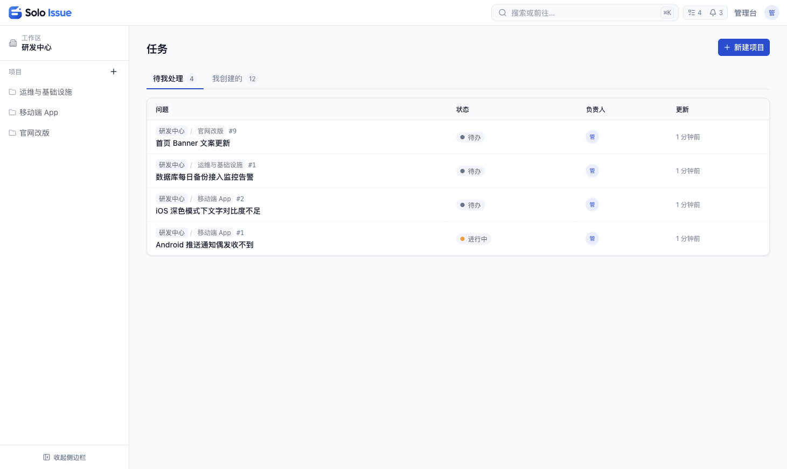
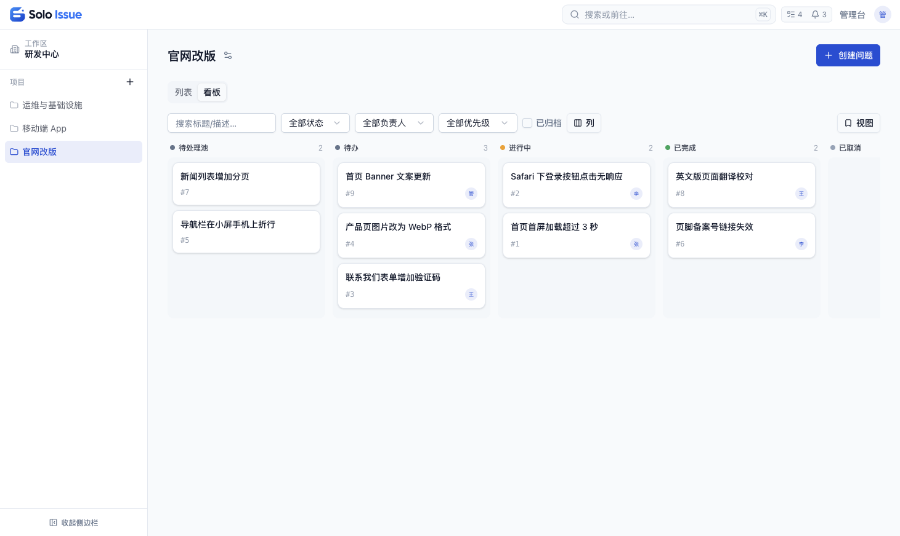
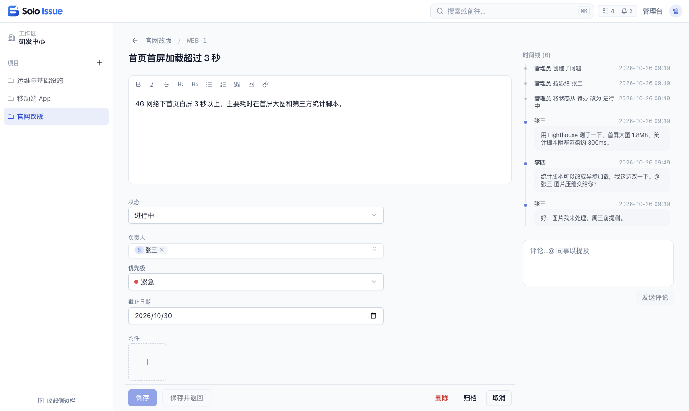

# Solo Issue


给个人和小团队用的问题追踪工具：把要做的事、要修的 bug 记下来，分给负责人，跟到完成。部署在你自己的服务器或电脑上，数据只存在你自己的数据库里。团队用企业微信的话，可以直接用企业微信身份登录，提醒也会推送到企业微信。

MIT 开源，免费使用。当前是 0.0.1 内测版本。

## 1. 适合谁

- 团队日常沟通用企业微信，希望群里提到的问题有地方记录、有人负责、能查进度
- 数据需要存在自己的服务器上，不能使用第三方在线服务
- 觉得 Jira、禅道这类工具太重，只需要"记问题、分负责人、跟状态"
- 个人开发者，想在自己电脑上管理项目任务

不适合需要迭代计划、路线图、甘特图或工时统计的团队，这些功能 Solo Issue 不做（边界见[架构与设计](docs/01-architecture.md) §2.2，代价与适用面见其 §7）。

## 2. 它能帮你做什么

### 2.1 群里说过的事，有地方落地

每个问题都有项目内的固定编号和固定链接。把链接贴到群里，大家打开的是同一个问题：描述、讨论、附件和处理进度都在这一页。

### 2.2 相关的人会收到提醒

问题指派给你、有人 @你、你负责或创建的问题状态变了、你参与过的问题有了新评论，都会出现在站内通知里。接入企业微信后，同样的提醒会推送到企业微信，消息里附带问题链接（推送内容包含问题标题和摘要，会经过企业微信的服务器）。企业微信推送可以按提醒类型单独关闭。

### 2.3 谁在什么时候改了什么，都有记录

状态、负责人、标题、描述、自定义字段的每次修改，以及每条评论，都会记下操作人和时间，显示在问题的时间线里。需要保留历史的问题请用"归档"：删除问题会连同它的记录一起删掉。

### 2.4 按团队习惯加字段

优先级、严重程度、客户名称、截止日期这类信息，在项目设置里自己添加，支持文本、数字、日期、单选、多选、成员六种类型。新建问题的表单和问题列表会自动显示这些字段，单选、多选字段还可以用来筛选。一个项目配好的字段可以导出，再导入到其他项目。

### 2.5 看板和列表随时切换

看板里拖动卡片就能改状态。列表可以按状态、负责人和字段筛选，常用的筛选条件可以保存下来。描述和评论支持富文本、粘贴图片和上传附件。

### 2.6 项目可以只对部分人可见

工作区成员分为负责人、成员、访客三种角色，访客只能查看、不能修改。不希望整个工作区都看到的项目可以设为私有，只有项目成员和工作区负责人能看到。

### 2.7 让 AI 助手帮你建问题、查进度

提供 REST API 和 MCP 服务器，Claude 等支持 MCP 的 AI 助手可以查询、创建和更新问题，也可以发表评论。AI 使用你签发的令牌访问：操作记在令牌所属账号名下，权限不超过这个账号本身。接入方法见 [AGENTS.md](AGENTS.md) 和 [packages/mcp/README.md](packages/mcp/README.md)。

### 2.8 部署和维护不复杂

一台机器、一条 `docker compose` 命令就能启动。只需要 PostgreSQL 一个数据库，不需要另外搭缓存或消息队列服务。备份时只需要备份数据库和附件目录。界面支持中文和英文。

## 3. 界面预览

截图一：工作区首页



截图二：项目看板



截图三：问题详情与编辑



## 4. 五分钟试用

### 4.1 准备

一台安装了 Docker 和 Docker Compose 的电脑或服务器，8081 端口空闲。

### 4.2 下载并配置

```bash
git clone https://github.com/xesam/solo-issue.git solo-issue
cd solo-issue
cp apps/web/.env.example apps/web/.env
```

在 `apps/web/.env` 中设置管理员账号。不设置密码时，启动后无法用邮箱登录：

```bash
ADMIN_EMAIL=admin@example.com
ADMIN_INIT_PASSWORD=change-me-on-first-login
```

在国内构建时，取消 `apps/web/.env` 里这三行的注释可以加快依赖下载：

```bash
DEBIAN_MIRROR=mirrors.huaweicloud.com
NPM_REGISTRY=https://registry.npmmirror.com
PRISMA_MIRROR=https://registry.npmmirror.com/-/binary/prisma
```

### 4.3 启动

```bash
docker compose --env-file apps/web/.env up --build -d
```

首次启动需要构建镜像，耗时取决于网络。

### 4.4 登录

打开 <http://localhost:8081/solo-issue>，用上面设置的邮箱和密码登录，首次登录时按提示修改密码。

通过服务器 IP 用 http 访问时，需要在 `apps/web/.env` 中加上 `ALLOW_INSECURE_COOKIES=1`，然后重新执行启动命令，否则登录后会被退回登录页。用 localhost 访问时如果也出现这种情况，同样加上这一项。

## 5. 下一步

| 想做的事 | 文档 |
|---|---|
| 部署到服务器长期使用（HTTPS、备份、升级） | [docs/08-deployment.md](docs/08-deployment.md) |
| 接入企业微信，让同事免注册登录、收到推送 | [docs/09-wecom-setup.md](docs/09-wecom-setup.md) |
| 了解架构与设计取舍，判断是否适合自己 | [docs/01-architecture.md](docs/01-architecture.md) |
| 让 AI 助手接入 | [AGENTS.md](AGENTS.md) |
| 本地开发、参与贡献 | [docs/README.md](docs/README.md) |

## 6. 技术栈

<details>
<summary>展开</summary>

| 层 | 选型 |
|---|---|
| 应用 | Next.js 15（App Router，页面和 API 在同一个应用里） |
| 数据库 | PostgreSQL 15/16 + Prisma |
| 后台任务 | pg-boss（任务队列运行在 PostgreSQL 上） |
| 前端 | React 19、TanStack Query、dnd-kit、Tailwind CSS 4、shadcn/ui |
| 富文本 | Tiptap |

</details>

## 7. 许可证

[MIT](LICENSE)
