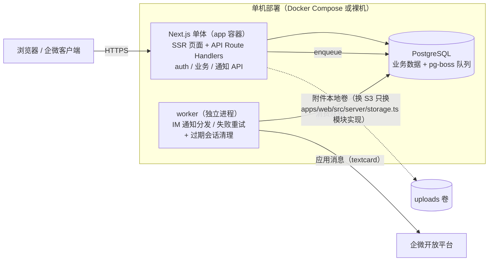
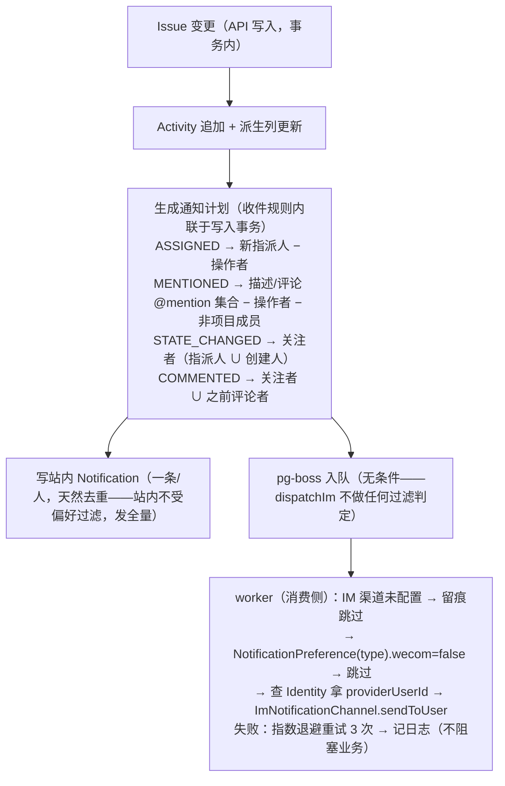

# 架构与设计

> 本文回答「系统是什么、为什么这样设计」：目标、技术选型、整体架构与核心机制。
> 数据模型见 [02-data-model.md](02-data-model.md)；认证与 IM 渠道见 [03-auth.md](03-auth.md)；工作区/权限模型见 [04-workspace-design.md](04-workspace-design.md)；API 见 [06-api-contract.md](06-api-contract.md)。

## 1. 目标与设计原则

| 目标 | 对设计的约束 |
|---|---|
| 轻量级 | 2-3 个容器（应用 + worker + PostgreSQL），无 Redis/RabbitMQ/MinIO 等额外中间件 |
| Issue 追踪核心 | 不做迭代/路线图/甘特；状态、看板、列表、过滤器；标签/优先级等分类数据由自定义字段承载 |
| 富文本扩展位 | 富文本编辑器与数据格式（Tiptap JSON）全局统一，issue 描述/评论共用 |
| AI Agent 友好 | API 面向「机器消费」设计：REST + API Token + 结构化活动日志 |
| 个人/团队皆可，IM 可选 | 个人本地与团队服务器同一套单机部署；邮箱密码为登录基线，企微/钉钉 OAuth **可选**接入——不接 IM 时站内通知兜底，接入后通知直达 IM |

**设计原则**

1. 单体优先，模块边界清晰（为未来拆分留缝，不提前拆）
2. 活动日志（Activity）是唯一事实源：审计、通知、AI 上下文全部从它派生
3. IM 渠道抽象成 Provider/Channel 接口：加飞书 = 加一个 adapter，零 schema 改动
4. 借鉴成熟开源项目验证过的设计思想，不复制任何 AGPL 代码（见 §5.3）

## 2. 技术选型

### 2.1 选型清单

| 层 | 选型 | 理由 |
|---|---|---|
| 应用 | **Next.js 15 (App Router)** 单体 | 前后端同仓同语言，类型端到端共享 |
| ORM/迁移 | **Prisma + PostgreSQL**（15/16 均可） | schema 即文档，迁移内建 |
| 校验 | Zod | API 入参/表单/环境变量统一校验 |
| 会话 | DB Session + httpOnly Cookie（自研） | 可吊销、无外部依赖 |
| 异步任务 | **pg-boss**（Postgres-backed 队列） | 免 Redis；通知分发/失败重试够用 |
| 富文本 | **Tiptap**（mention 扩展） | JSON 文档模型，issue 描述/评论共用 |
| 服务端状态 | TanStack Query（获取/缓存标准化） | 数据获取与缓存统一走 query |
| 看板/列表 | dnd-kit（拖拽）+ 自研 `IssueTable`（统一 [TableShell](07-ui-guidelines.md) 外壳） | 看板拖拽排序、列表表格视图 |
| 样式 | Tailwind CSS v4 + shadcn/ui 令牌体系 | 短路径开发，主题可换肤（见 [07-ui-guidelines.md](07-ui-guidelines.md)） |
| 部署 | Docker Compose（app / worker / postgres） | 单机部署（见 [08-deployment.md](08-deployment.md)） |

### 2.2 明确不做（产品边界）

- 迭代/Cycle、模块/路线图、甘特图
- 工时/估点（estimate）
- 细粒度行级权限（只做 workspace/project 两级角色）
- 实时协同（Yjs）
- 邮件通知（IM 覆盖率高于邮箱；通知渠道抽象已预留）

## 3. 系统架构

- **app 与 worker 为同一镜像、不同入口命令**；极小部署可合并为一个容器
- 附件存本地卷（app 进程挂载），存储层是 `apps/web/src/server/storage.ts` 模块（当前本地磁盘实现，换 S3/MinIO 只改该模块）
- 企微应用凭据以 `WECOM_*` 环境变量为主路径（直读见 `server/im/wecom/config.ts`，`ProviderCredential` 表为备选，见 [02-data-model.md](02-data-model.md) §3.6），secret 不进日志；钉钉仅为 schema 预注册枚举（`DINGTALK`），当前无独立环境变量与实现
- 站内通知的生成在 app 进程事务内完成；IM 推送经 pg-boss 队列交 worker 异步执行——缺 worker 时站内通知正常，IM 推送不会发出

## 4. 核心机制

### 4.1 Activity 是唯一事实源

所有 issue 变更（状态、指派、标题、自定义字段、归档、评论）先 diff 成 `activities` 行再落库（append-only，`field = custom:<key>` 标识自定义字段）。审计、通知、AI 上下文、时间线全部从这一张表读，无需额外同步逻辑。数据结构见 [02-data-model.md](02-data-model.md) §3.5。

### 4.2 IM 渠道抽象

渠道行为集中在两个接口（完整签名见 [03-auth.md](03-auth.md) §4）：

- `ImIdentityProvider`：登录（构建授权 URL、code 换身份）
- `ImNotificationChannel`：通知（发个人消息、群机器人 webhook）

新增飞书 = 写一个 adapter 文件并拓宽接口 `id` 联合类型后注册（`FEISHU`/`DINGTALK` 均已在 schema 预注册枚举，接口见 [03-auth.md](03-auth.md) §4），**核心代码与 schema 零改动**。企微侧端点清单与 token 缓存纪律见 [03-auth.md](03-auth.md) §5。

### 4.3 权限 = 成员关系，治理与业务正交

- 业务面：一切业务权限从 `WorkspaceMember.role`（OWNER/MEMBER/GUEST）派生；私有项目叠加 `ProjectMember` 收紧阀——完整推演见 [04-workspace-design.md](04-workspace-design.md)
- 治理面：`User.isAdmin` 只解锁管理台，不穿透业务数据
- Agent 面：Bearer 令牌权限 = **scope ∩ 所属用户角色**，无越权能力（见 [AGENTS.md](../AGENTS.md)）

### 4.4 通知系统设计

- 通知收件规则内联于 issue/comment 写入事务（规则与事务混在同一处），行为由集成测试背书；精度注：更新路径仅**新提及**触发（旧提及不重复打扰），评论中被 @ 者从 COMMENTED 收件人中剔除不重复通知
- 偏好结构 `{ [type]: { wecom } }` 走 JSONB（加渠道零迁移，`dingtalk` 等为未来扩展键）；站内通知不做偏好过滤、发全量——过滤只作用于 IM 推送（worker 消费侧，见 `im-send.ts`）
- 自定义字段可挂**字段级通知规则**（值命中触发，走 afterWrite 钩子不改引擎核心），见 [05-custom-fields.md](05-custom-fields.md) §5
- 策略：**即时发送**，不做攒批（IM 场景实时性优先；后续如嫌吵再加 digest/安静时段）

## 5. 扩展预留

### 5.1 AI Agent 接入点

- **ApiToken + scopes**：Agent 以某用户身份调 REST，权限与真人一致
- **面向 Agent 的 API 约定**：REST 资源化、分页/过滤参数稳定、错误码结构化
- **MCP 服务器包**：`packages/mcp`（npm 名 `solo-issue-mcp`）把上述 REST 面包装为 stdio MCP 工具面，纯透传、不持业务规则，设计见 [11-mcp-adapter.md](11-mcp-adapter.md)
- **Activity 表是 Agent 的眼睛**：审计与「这个 issue 发生了什么」的天然 RAG 素材
- **通知反向通道**：Agent 产生的动作同样写 Activity → 走通知管道推给同事，无需为 Agent 单写通知代码

> Agent API 完整工具说明（认证/scope/端点/错误语义/最佳实践）见根目录 [AGENTS.md](../AGENTS.md)。

### 5.2 自定义字段

Issue 固定字段（标题/描述/状态/指派人）之外，**项目可按需扩展字段**，不破坏三条主线（Activity 唯一事实源、REST-first Agent 面、两级权限）。优先级/标签/日期等分类数据由自定义字段承载；存储采用「定义表 + JSONB 值」路线——完整设计（类型注册表/写入链路/过滤/Agent schema）见 [05-custom-fields.md](05-custom-fields.md)。

### 5.3 上游借鉴红线

Plane（AGPL-3.0）等开源项目只允许**阅读学习其设计**：可借鉴数据模型概念、流程编排思想；**不得复制其任何代码**进本仓库。开源发布时注意保持此边界，不引入其源码片段、不翻译其注释。

## 6. 后续扩展方向（不承诺排期）

- **钉钉登录/通知接入**：接口已抽象，加 adapter 即可
- **群机器人**：`ImWebhook` 模型已预留（接口尚未含 `sendToWebhook`，见 [03-auth.md](03-auth.md) §4）
- **手动关注 issue、通知聚合**（digest/安静时段）

> MCP 适配器（`packages/mcp`）、保存视图（IssueView）与项目成员管理均已落地，不在规划内重复列出——现状以 [02-data-model.md](02-data-model.md) 与 [06-api-contract.md](06-api-contract.md) 为准。

## 7. 设计取舍与适用边界

> 前文各节回答「系统是什么、为什么这样设计」；本节补「为此付出的代价」与「适合谁/不适合谁」——评估是否采用本系统时，代价面比收益面更值得逐条对照。

### 7.1 各项取舍付出的代价

| 取舍 | 付出的代价 |
|---|---|
| 单机单体（§1/§3） | 不支持多实例分担负载：登录限流与 API 频控的计数在进程内存（重启清零、实例间不共享），附件在本机磁盘；未做容量压测，承载量无官方数字 |
| 外部依赖仅 PostgreSQL（§2.1） | 会话校验每次查库；后台任务吞吐随数据库性能走 |
| Activity 同事务追加（§4.1） | 每次修改多一次写入，记录随使用持续增长；删除 issue 时活动与通知级联删除——需要留史用「归档」，不用「删除」 |
| 企微为增强项（§4.2） | 接入需公网域名、固定服务器出口 IP 与反向代理（见 [08-deployment.md](08-deployment.md) §4）；推送时问题标题与摘要经企业微信服务器；当前仅企微实现，钉钉/飞书为 schema 预留 |
| 两级权限（§4.3，完整见 [04-workspace-design.md](04-workspace-design.md)） | 不做单个问题级别的权限（「这个问题只有某几个人能看」）；需要隔离的内容放进私有项目 |
| 附件本地存储（§3） | 多机不共享；换对象存储只改 `apps/web/src/server/storage.ts` 模块——应用代码中仅该模块直接读写磁盘 |

### 7.2 适合与不适合

| 适合 | 不适合 |
|---|---|
| 个人在自己电脑上管理项目 | 需要多台服务器分担负载 |
| 一台服务器就够用的团队 | 需要迭代、路线图、甘特图 |
| 数据需要存在自己的服务器上 | 需要单个问题级别的权限 |
| 团队日常使用企业微信 | 主要使用钉钉或飞书，并且需要消息推送 |

需要迭代管理或路线图时，Jira、Linear 等工具更合适。
