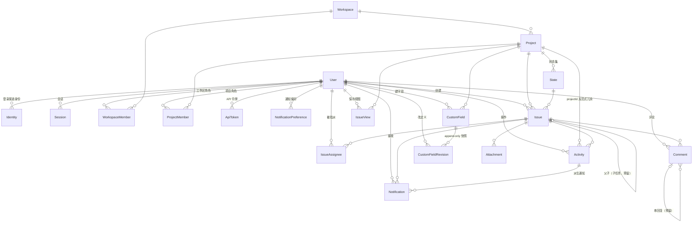

# 数据模型

> 完整 schema 的现役定义以 [apps/web/prisma/schema.prisma](../apps/web/prisma/schema.prisma) 为唯一事实源（文档不再整体复制代码，防漂移）；本文解释结构、语义与关键不变量。
> 依据：`apps/web/prisma/schema.prisma` · `apps/web/src/server/services/*` · 总体架构见 [01-architecture.md](01-architecture.md)

## 1. ER 总览

分组阅读：**用户与身份**（User/Identity/Session）、**组织结构**（Workspace/Project 与两级成员表）、**Issue 核心**（Issue/State/Comment/Attachment/IssueView）、**自定义字段**（CustomField/CustomFieldRevision + `Issue.fieldValues`）、**活动与通知**（Activity/Notification/MockMessage）、**集成与凭证**（ApiToken/ImWebhook/ProviderCredential）。

## 2. 主干字段归属原则

Issue 的固定主干只保留两类字段：

- **行为语义字段留主干**：State（`StateGroup` 分组驱动自动化/统计）与指派人（处理人行为，影响通知与「待我处理」）
- **纯数据字段不建固定列**：标签、优先级、开始/目标日期等一律由项目级自定义字段承接（标签 → 多选 SELECT、优先级 → SELECT、日期 → DATE）

判定一句话：**字段要不要长出行为，决定它在不在主干**（完整机制见 [05-custom-fields.md](05-custom-fields.md)）。

## 3. 模型语义要点

> 下述只列语义与不变量；字段/索引/映射名的现役清单看 [apps/web/prisma/schema.prisma](../apps/web/prisma/schema.prisma)。

### 3.1 用户与身份（User / Identity / Session）

| 模型 | 语义要点 |
|---|---|
| `User` | `email` 唯一且可空——**仅是邮箱建号账号的登录键**（+`passwordHash`）；`origin` 记录建号来源（与 Identity 集正交，见 §5）；`mustChangePassword` 首登/重置后强制改密旗标；`isAdmin` 实例管理员（治理面，与业务权限正交）；`isActive=false` 停用（登录 403，数据保留） |
| `Identity` | 渠道身份与 User 解耦：`(provider, providerUserId)` 全局唯一；同一自然人经企微、钉钉登录 = **两个不同账号** |
| `Session` | `id` 即随机 token 的 SHA-256 哈希（明文不落库）；可吊销、30 天过期，worker 定时清理 |

### 3.2 组织结构（Workspace / Project / 两级成员表）

| 模型 | 语义要点 |
|---|---|
| `Workspace` | 刻意做「薄」：仅 `slug/name/icon` 等基础列 + 成员关系 + 项目——它是**权限原语**而非功能容器（推演见 [04-workspace-design.md](04-workspace-design.md)） |
| `WorkspaceMember` | 复合主键 `(workspaceId, userId)`，`WorkspaceRole ∈ OWNER/MEMBER/GUEST`——**一切业务权限的单一来源** |
| `Project` | `@@unique([workspaceId, slug])`（项目 slug 只在工作区内唯一）；`issueSeq` 项目内 issue 计数器（事务内自增）；`isPrivate` 私有项目开关；`leadUserId` 项目负责人（预留：当前无设置端点，仅通知目标 `PROJECT_LEAD` 等读取方消费） |
| `ProjectMember` | 复合主键 `(projectId, userId)`，`ProjectRole ∈ ADMIN/MEMBER/GUEST`；**平时闲置，私有项目可见性与字段/状态定义管理才激活**——工作区角色之上的收紧阀门 |
| `IssueView` | 保存视图：过滤器/排序的命名快照（`query` = IssueFilters JSON，含自定义字段过滤） |

### 3.3 Issue 核心（Issue / State / Comment / Attachment）

| 模型 | 语义要点 |
|---|---|
| `Issue` | `number` 项目内序号（`@@unique([projectId, number])`，展示 `PROJ-123`）；`description`(Tiptap JSON) + `descriptionText`(派生纯文本) 双存储；`stateId` 删除时 SetNull；`parentId` 子任务预留（自引用层级，当前无写入路径）；`completedAt` 进入 COMPLETED 组自动打、移出自动清；`isArchived` 归档软删 |
| `State` | `group ∈ ACTIVE/COMPLETED/CANCELLED` **三档结局分类**——只有 COMPLETED 与 CANCELLED 被系统消费（统计/待我处理排除）；「待办/进行中」等阶段语义由项目级状态名表达，不进枚举；`@@unique([projectId, name])` 唯一 |
| `IssueAssignee` | 复合主键 `(issueId, userId)`，多指派；写入前过可见性护栏 `assertUsersVisible`（防幽灵任务，422） |
| `Comment` | `body`(Tiptap JSON，含 @mention 节点) + `bodyText`(派生纯文本) 同一双存储模式；`parentId` 串回复预留（当前无写入路径）；`isDeleted` 逻辑删（正文保留） |
| `Attachment` | `storageKey` 由存储模块（`apps/web/src/server/storage.ts`）解释；`commentId` 为预留字段（现役写入路径仅 issueId，附件鉴权解析链已支持 commentId → issue） |

### 3.4 自定义字段（CustomField / CustomFieldRevision / Issue.fieldValues）

定义与值分离（完整设计见 [05-custom-fields.md](05-custom-fields.md)）：

| 模型 | 语义要点 |
|---|---|
| `CustomField` | 项目级定义：`key`/`type` 创建后**不可变**（Agent API、保存视图、Activity 的 `custom:<key>` 都依赖 key 稳定）；`options` 承载 SELECT 选项、`settings` 承载类型专属配置（`multiple`/`notifyOn`）；`isArchived` 归档软删（历史值保留，表单/必填/过滤不再纳入）；`version` 定义变更计数 |
| `CustomFieldRevision` | 每次定义变更 append 一份完整快照（append-only 审计，**不支持回滚**） |
| `Issue.fieldValues` | JSONB 列存值 `{key: value}`；GIN 索引支持等值/包含过滤（随基线迁移生成，见 §6） |

### 3.5 活动与通知（Activity / Notification / MockMessage）

| 模型 | 语义要点 |
|---|---|
| `Activity` | **append-only 唯一事实源**：`action`（9 类）/`field`（变更字段，自定义字段为 `custom:<key>`）/`oldValue`/`newValue` 组成 JSONB diff；`projectId` 反范式冗余供项目级 feed/统计；审计、通知、时间线、AI 上下文全部从它派生 |
| `Notification` | 从 Activity 派生；`@@unique([userId, activityId, type])` **天然去重**；`url` 深链直跳 issue |
| `NotificationPreference` | `prefs` JSONB 结构 `{ [type]: { wecom } }`——加渠道零迁移（`dingtalk` 等为未来扩展键）；`wecom` 键作用于 IM 推送过滤（worker 消费侧），站内通知发全量不做过滤；`projectId=null` 表示全局默认（PG 对 NULL 唯一性不敏感，应用层保证单行） |
| `MockMessage` | 仅 `ALLOW_IM_MOCK` 模式写入的模拟收件箱——验证 IM 推送文案/去重/频控的可视化工具 |

### 3.6 集成与凭证（ApiToken / ImWebhook / ProviderCredential）

| 模型 | 语义要点 |
|---|---|
| `ApiToken` | Agent 访问凭证：`tokenHash` 哈希入库（明文仅签发时返回一次）；`scopes` 白名单单源 `apps/web/src/lib/scopes.ts`；`expiresAt` 限期令牌；内存频控 120 次/分/令牌 |
| `ImWebhook` | 群机器人（**预留**）：项目级 IM 群推送，`events` 订阅 ActivityAction 列表 |
| `ProviderCredential` | IM 应用凭据的**预留读路径**（env 优先；当前无管理端写入端点，接入管理台前不可用）；`config` 中的 secret 不进日志 |

## 4. 关键设计决策

| 决策 | 说明 |
|---|---|
| State 按 `group` 分组 | 三档结局分类驱动行为：COMPLETED 自动 `completedAt`；CANCELLED 与 COMPLETED 共同决定「待我处理」排除与修复统计口径；阶段词汇由项目级状态名表达 |
| 每项目 issue 序号 | `Project.issueSeq` 事务内 `UPDATE ... RETURNING`，展示 `PROJ-123` 人类可读 |
| 派生纯文本双存储 | 富文本源（`description`/`body`，Tiptap JSON）与派生纯文本列（`descriptionText`/`bodyText`，`apps/web/src/lib/tiptap-text.ts` 派生，提及渲染为 `@名字`）并存——搜索、IM 摘要、AI 全部消费纯文本列 |
| Activity append-only + JSONB diff | 通知收件规则内联于 issue/comment 写入事务，行为由集成测试背书 |
| 偏好用 JSONB（类型×渠道矩阵） | 固定布尔列加渠道要 DDL 迁移；JSONB 加渠道零迁移 |
| Identity 独立表 | 登录渠道与 User 解耦，渠道身份互不相通 |
| 删除语义分层 | 归档软删（Issue/CustomField/选项）、停用（`User.isActive`）、评论逻辑删（`isDeleted`）；**其余物理删**（FK 级联），保持数据模型直白。项目删除有 0-issue 护栏 |

## 5. 身份与建号来源（身份模型 v2）

同一自然人经企微、钉钉登录 = **不同账号**（渠道身份互不相通）：

- **email 对 IM 登录是纯档案属性**：不作为匹配/合并/登录凭据——渠道侧邮箱可自填/自改时即构成账号接管向量
- **IM 建号不写 `User.email`**：email 保持「邮箱建号账号的登录键」单一职责，永不与 IM 身份复合；同邮箱撞库/抢注在此结构上不再可能
- **`User.origin` 记录建号来源**：EMAIL（管理端/脚本/seed 建号）/ WECOM / DINGTALK /…——建号渠道的出生事实，与 Identity 集（可登录渠道）为两个正交维度
- **`providerUserId` 语义稳定性由使用方自担**：系统不做同渠道兜底合并；渠道侧 id 语义若变，按新 id 建新账号
- **展示层「凭据标识」槽位**：管理列表/成员选择器/@提及候选中，IM 账号显示建号渠道、邮箱账号保留 email 文本（`apps/web/src/lib/origin-labels.ts` 单源映射）

IM 渠道身份失效（如离职被移出通讯录）时的行为与补偿通道见 [03-auth.md](03-auth.md) §6。

## 6. 基线迁移的特殊说明

- `Issue.fieldValues` 的 GIN 索引由 schema 直接表达（`@@index([fieldValues], type: Gin)`，Prisma 6 起支持），随基线迁移一同生成——改 schema 时由迁移流程统一维护，无手工 SQL
- `Attachment.commentId` 为预留字段：当前无写入方，接线时须同步接附件鉴权（服务层 `resolveAttachmentAccess` 已支持 commentId → comment → issue → project 解析）
