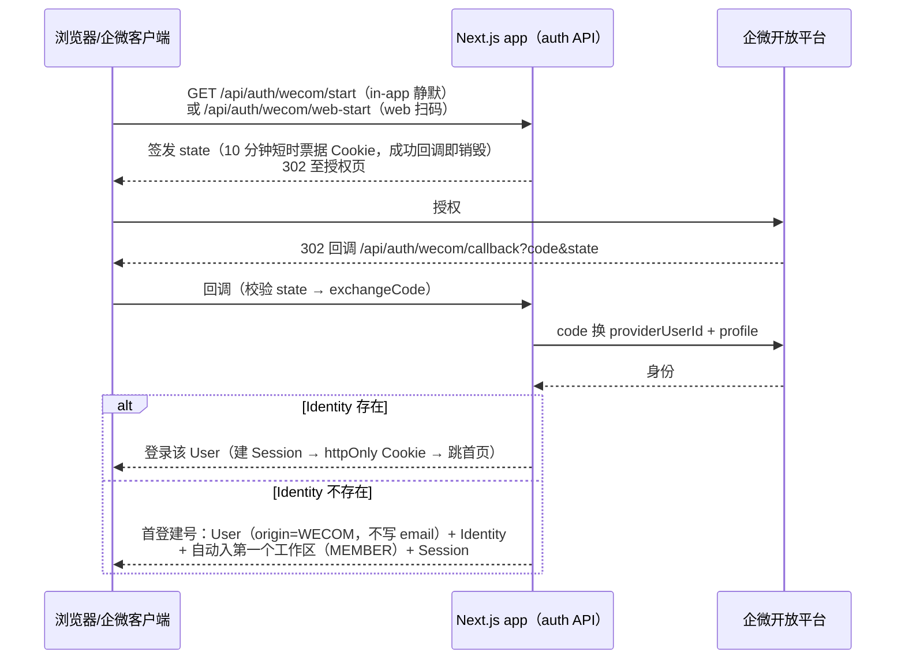

# 认证与 IM 渠道

> 谁能登录、怎么登录、IM 渠道如何抽象、渠道身份失效如何恢复。
> 身份数据模型见 [02-data-model.md](02-data-model.md)；API 鉴权约定见 [06-api-contract.md](06-api-contract.md)；Agent 令牌（Bearer）见根目录 [AGENTS.md](../AGENTS.md)。

## 1. 鉴权双通道

| 通道 | 凭证 | 适用 | 说明 |
|---|---|---|---|
| 会话 | `it_session` httpOnly Cookie | 人类（浏览器） | DB Session：明文 token 仅存于 Cookie，库中只存其 SHA-256 哈希；可吊销、30 天过期，worker 定时清理 |
| 令牌 | `Authorization: Bearer itr_*` | AI Agent / 外部集成 | scope 判定与禁区见 [AGENTS.md](../AGENTS.md)；`/api/auth/*` 一律 403——Agent 无法触碰认证面 |

**强制改密护栏**：`mustChangePassword=true`（管理员建号/重置后）时，所有经 `requireApiUser` 的业务 API 一律 403（错误 key `errors.mustChangePassword`，文案随 locale 变化），仅 `/api/auth/password` 与 `/api/auth/logout` 可达——UI 依赖登录响应中的 `mustChangePassword` 跳转 `/change-password`。令牌通道不受此护栏影响（针对的是「初始/临时密码可能外泄」，与令牌凭证无关）。

## 2. 登录方式

| 方式 | 端点 | 说明 |
|---|---|---|
| 邮箱密码 | `POST /api/auth/login` | 防枚举（统一文案/恒时比较）；停用账号 403；首登返回 `mustChangePassword` |
| 企微客户端免登 | `GET /api/auth/wecom/start` | 企微内建应用定位：企微客户端内（UA 含 wxwork）静默授权 snsapi_base，免跳转登录 |
| 企微 PC 扫码 | `GET /api/auth/wecom/web-start` | 系统浏览器走 wwlogin 扫码登录；mock 模式回落站内模拟页 |
| 开发直登 | `POST /api/auth/dev-login` | `ALLOW_DEV_LOGIN` 显式设置优先（`true`/`false`）；未设置时非生产默认开、生产默认关，初始化/救急临时用 |
| 入口探测 | `GET /api/auth/providers` | 登录页按 provider 的 `supportedFlows` 匹配展示入口 |

企微双入口（start / web-start）URL 与限流各自独立，**殊途同归到同一 callback**（`flow` 参数区分流程语境）。仅限本企业可见范围内成员，可见范围外成员无法登录成功。

## 3. OAuth 流程与身份解析



身份解析遵循**身份模型 v2**（见 [02-data-model.md](02-data-model.md) §5）：渠道身份互不相通、email 不参与匹配合并；同一成员经企微免登与 PC 扫码两种方式登录，落在同一账号（同一 `(provider, providerUserId)` 键）。

## 4. IM Provider 接口规范

现役定义（`apps/web/src/server/im/types.ts`）：

```ts
export type ImLoginFlow = "in-app" | "web";   // 客户端内静默 / 系统浏览器扫码

export interface ImIdentityResult {
  providerUserId: string;    // 企微 userid；mock 通道落库的 Identity 键一律 "mock:new:<name>"（"mock:<userId>" 是授权页 code 形态，非身份键）
  name?: string;
  email?: string | null;     // 纯档案属性：不参与匹配/合并，建号不写入 User.email
  avatarUrl?: string | null;
  metadata?: Record<string, unknown>;
}

export interface ImIdentityProvider {
  id: "WECOM";
  mode: "real" | "mock";
  supportedFlows: readonly ImLoginFlow[];      // providers API 原样下发
  buildAuthUrl(flow, params: { state, redirectUri, userAgent? }): Promise<string>;
  exchangeCode(flow, code): Promise<ImIdentityResult>;
}

export interface ImMessage { title: string; summary: string; url: string }

export interface ImNotificationChannel {
  id: "WECOM";
  mode: "real" | "mock";
  sendToUser(providerUserId: string, message: ImMessage, locale?: Locale): Promise<void>;  // locale 为 worker 推送快照（旧 job 缺省回退英文）
}
```

**加一个渠道（如钉钉/飞书）的改动面**：`DINGTALK`/`FEISHU` 均已在 `IdentityProvider`/`UserOrigin` 枚举预注册，接入只需上述接口 `id` 联合类型拓宽 + 一个 adapter 文件——核心流程与 schema 零改动。群机器人仅预留了 `ImWebhook` 数据模型（[02-data-model.md](02-data-model.md) §3.6），接口尚未含 `sendToWebhook`。

## 5. 渠道端点要点（以官方文档为准）

### 5.1 企业微信（已接入）

| 用途 | 端点 |
|---|---|
| 企微内免登 | `open.weixin.qq.com/connect/oauth2/authorize`，scope=snsapi_base |
| code → userid | `GET /cgi-bin/auth/getuserinfo` |
| 成员详情 | `GET /cgi-bin/user/get`（姓名/邮箱/头像） |
| 应用凭证 | `GET /cgi-bin/gettoken`（corpid+secret，**有效期 7200s，必须集中缓存**） |
| 应用消息 | `POST /cgi-bin/message/send`（textcard：标题+摘要+跳转链接） |

### 5.2 钉钉（预留，接口已抽象）

| 用途 | 端点 |
|---|---|
| 扫码/统一登录 | `login.dingtalk.com/oauth2/auth`（scope=openid, prompt=consent） |
| code 换 token | `POST api.dingtalk.com/v1.0/oauth2/user_access_token` |
| 用户信息 | `GET api.dingtalk.com/v1.0/contact/users/me` → unionId |
| unionId → staffId | `POST oapi.dingtalk.com/topapi/user/getbyunionid`（发个人消息需要） |
| 个人通知 | 机器人单聊 `POST api.dingtalk.com/v1.0/robot/oToMessages/batchSend`（robotCode + staffId） |
| 群机器人 | `oapi.dingtalk.com/robot/send?access_token=`（支持 markdown） |

### 5.3 凭证与 token 缓存

- `WECOM_CORP_ID/WECOM_AGENT_ID/WECOM_SECRET` 环境变量为主路径；`ProviderCredential` 表为**预留读路径**（当前无管理端写入端点，接入管理台前不可用），secret 不进日志
- 企微 access_token 需集中缓存（7200s、提前 5 分钟过期）：**app 与 worker 是两个独立进程、各持一份进程内缓存**——企微重复获取会使旧 token 失效，任何一侧刷新都会踢掉另一侧缓存；两侧对 token 失效错误（40014/42001）均已实现「清缓存重取一次」自愈，瞬时互踢不致持续失败；多实例部署需换共享缓存（Redis）

## 6. 恢复预案：IM 渠道身份失效的补偿通道

### 6.1 接受面（设计定局，登记为已知行为）

IM 建号账号的唯一登录凭据是 `(provider, providerUserId)`：

- 渠道侧失效（如离职被移出通讯录）：`exchangeCode` 断在渠道一侧，请求到不了本系统，**登录立即不可达**，系统侧无感知、无清理
- 系统不维护对渠道侧成员状态的独立判断；`providerUserId` 语义稳定性由使用方对照渠道官方文档自担
- 数据无虞：账号、业务数据、站内通知与活动审计均不受渠道失效影响

### 6.2 恢复链（已落地）

| 手段 | 说明 |
|---|---|
| 管理台补写邮箱 | 「用户 → 编辑」支持补写/修改邮箱，登录键可后置修正；IM 建号账号补写 email 后，重置密码的 `!email` 护栏与改密卡片的通道判据自动解除，密码通道即刻兑现 |
| seed 参数化 | `ADMIN_EMAIL`（缺省占位 `solo-issue@github.com`）+ 可选 `ADMIN_INIT_PASSWORD`（设置初始密码，首登强制改密）——新部署出生即真实登录键 |
| 运维脚本 | `pnpm -C apps/web exec tsx scripts/ops-set-password.ts <email> [password]` 按 email 定位设密并吊销全部会话（不传密码则生成随机密码）——紧急恢复用；注意明文密码会打到 stdout |

管理端「重置密码」对无邮箱账号（IM 建号）422 拒绝——密码登录按 email 定位，重置的密码无处兑现为登录通道。

### 6.3 升级方向（出现首个真实的离职员工账号找回/交接需求时再评估）

| 形态 | 内容 | 依赖/前提 |
|---|---|---|
| 在职自助绑定 | 员工给自己账号绑一个邮箱以开辟密码通道 | 身份模型 v2 使自填不再是接管向量；需先防**邮箱命名空间抢注**（未验证 email 挤占唯一键，会阻断管理员为真人建号），且与「渠道失效即不可达」的接受面仅部分对冲 |
| 脚本放宽 | ops-set-password 类工具支持按 userId 定位并补写 email | 最小改动，无界面；适合一次性救急 |

## 7. mock 通道（仅本地/演示环境）

`ALLOW_IM_MOCK=1` 时（未显式设置时默认 `NODE_ENV !== "production"`），登录与通知走模拟通道，无需任何企微配置：

- **通讯录边界**：模拟授权页即「企微通讯录」替身，列表**仅含 origin=WECOM 成员**——邮箱建号账号不属于企微世界：不列出、code 解析直接拒绝（其登录入口是密码登录页）
- **新同事建号**：「新同事」表单构造 `mock:new:<name>` 全新身份，直接走企微首登建号链路（origin=WECOM、无 email，与真实语义一致）
- **成员登录**：以成员名下**已存在的企微身份键**为准（查 identity 表，不做字符串重构造——否则会克隆同名新账号）
- **通知验证**：IM 推送落到模拟收件箱——页面 `/mock/wecom-inbox`，API `GET /api/mock/messages`（Bearer 禁区）。收件箱消息由 mock 通道服务端直写 DB，无 POST 入口
- 生产默认关（`ALLOW_IM_MOCK` 建议 false）
