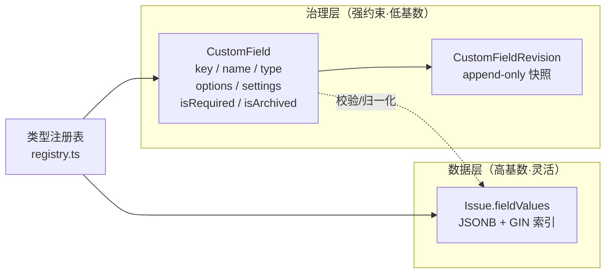
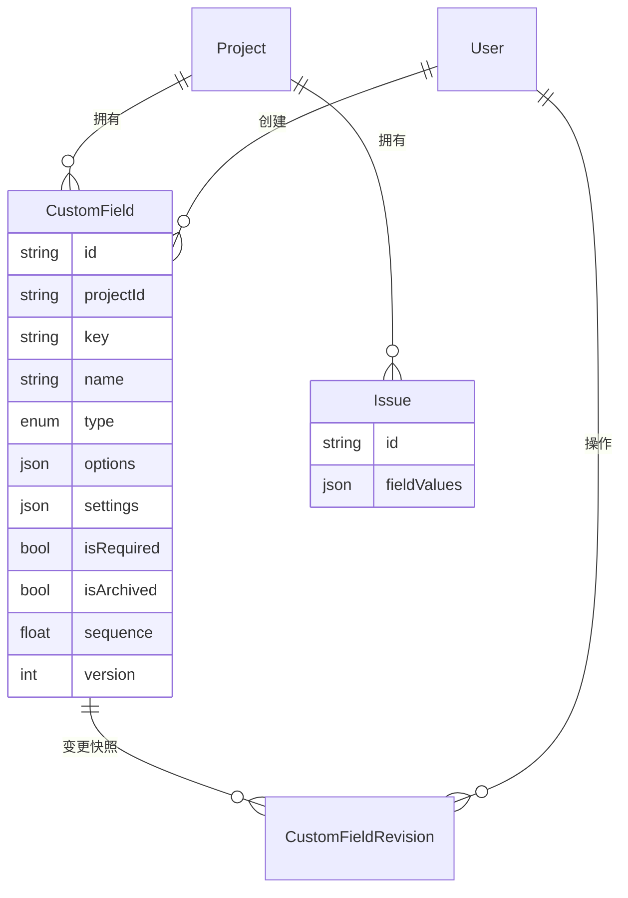
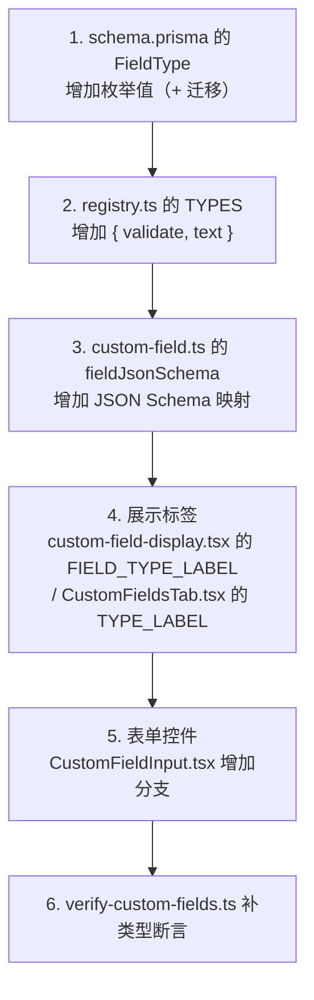
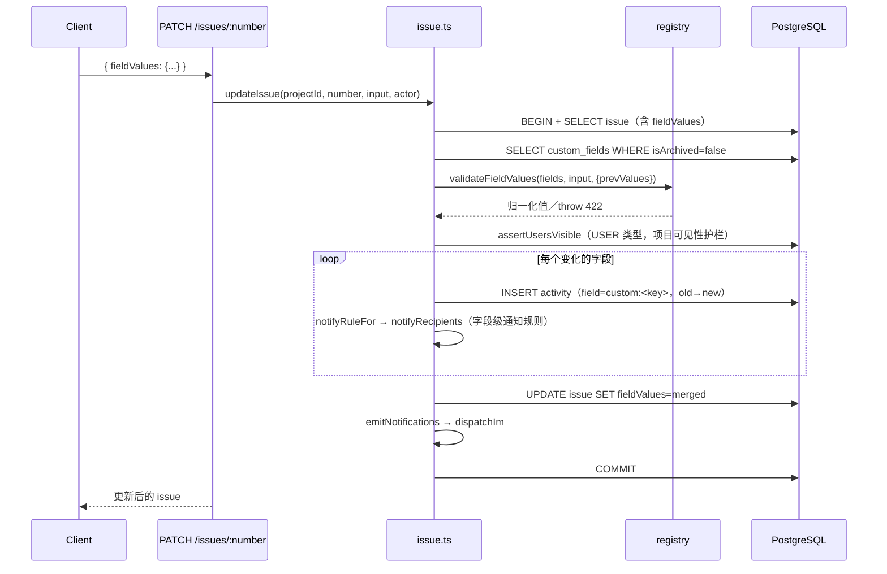
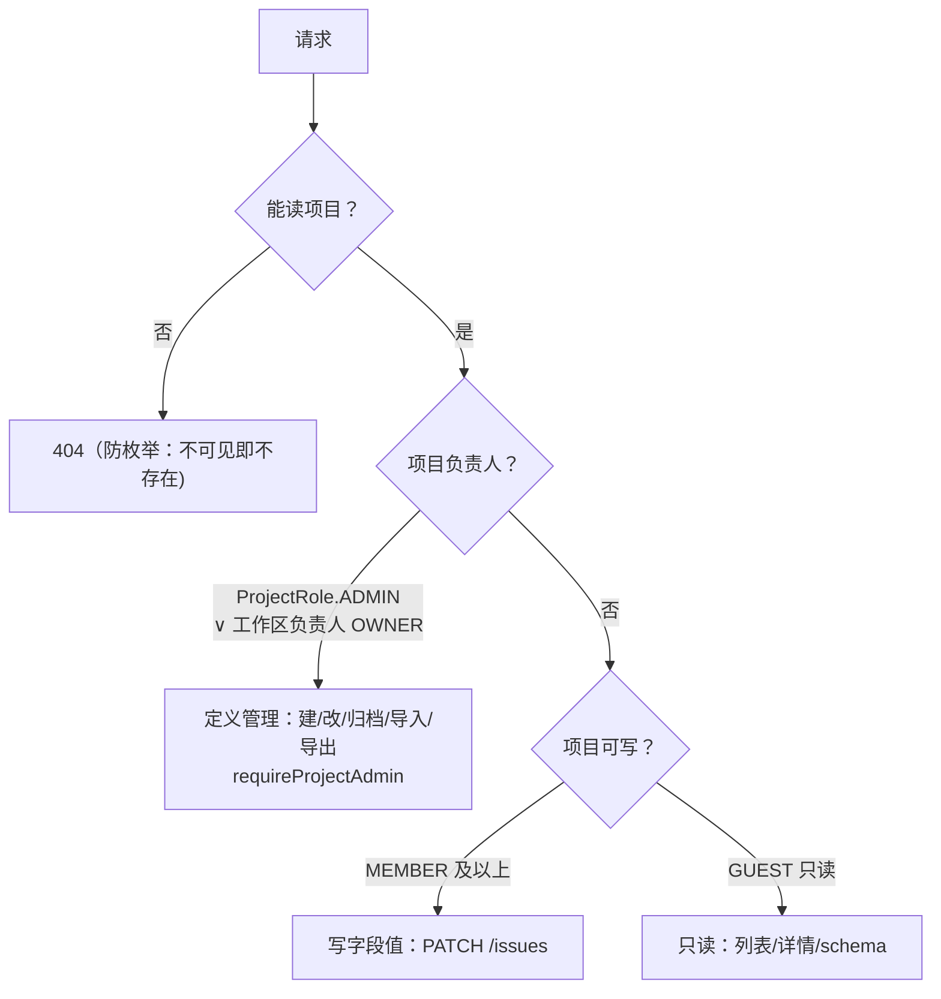

# 自定义字段设计

> 相关：[架构与设计](01-architecture.md) §5.2 · [数据模型](02-data-model.md) §3.4 · [API 契约](06-api-contract.md) · [Agent 接入](../AGENTS.md)

## 1. 背景与目标

### 1.1 问题

Issue 主干字段集是固定的（标题、描述、`stateId`、指派人…），而不同产品/团队有不同的字段诉求：
> **主干归属原则**：行为语义决定归属——State（分组驱动自动化/统计）与指派人（处理人行为）留主干；纯数据字段（标签、优先级、开始/目标日期等）一律不建固定列，由自定义字段承接（标签→多选 SELECT、优先级→SELECT、日期→DATE）。

- 产品 A 要「严重等级 / 影响版本 / 客户名称」
- 产品 B 要「工单来源 / SLA 时长 / 是否付费客户」
- 测试团队要「复现步骤数 / 环境 / 回归标记」

硬编码模型无法表达，只能改代码 + 迁移，违背「轻量级、项目自治」的定位。

### 1.2 目标

| 目标 | 约束 |
|---|---|
| 项目级自治 | 每个项目自定义自己的字段集，互不影响 |
| 不用改代码 | 类型/校验/表单/过滤/API 全部由定义驱动 |
| 强约束 | 类型校验、必填、枚举、未知 key 拒绝——而非「随便塞 JSON」 |
| 可移植 | 声明式导出导入，跨环境/跨产品复制字段模板 |
| 不破坏既有主干 | Activity 唯一事实源、通知引擎、Agent REST 面全部复用 |

### 1.3 非目标（明确不做）

- **不做任意建模**（Strapi 式 Content-Type Builder）：Issue 模型封闭，只需字段级扩展
- **不做动态 DDL / 每类型一张物理表**：与 Prisma migrate 体系冲突
- **不做字段间联动/公式**：Jira 的坑，轻量工具不进
- **不做按自定义字段排序**：仅过滤
- **不做必填追溯回填**：字段改为必填时，存量 issue 不追溯
- **不做定义回滚**：只 append 快照审计

## 2. 总体设计

### 2.1 核心决策：定义与值分离

借用 Strapi「内容类型定义」与「内容数据」分离的思想，但**不照搬其存储层**：



- **定义**存 `custom_fields` 表：强类型、可审计、项目级隔离
- **值**存 `issues.fieldValues`（JSONB）：高基数、无需 DDL、可索引
- **类型行为**集中在 `apps/web/src/server/custom-fields/registry.ts` 的类型注册表

### 2.2 为什么不选其他方案

| 方案 | 结论 | 原因 |
|---|---|---|
| 每项目建表（动态 DDL） | ❌ | 违背 Prisma 迁移体系，运维灾难 |
| 纯 JSONB 无定义 | ❌ | 无类型校验、无枚举、无必填、无法按字段过滤 |
| EAV 行存储 | ❌ | 类型不统一，过滤需多次 join，Prisma 查询别扭 |
| **定义表 + JSONB 值** | ✅ | 平衡点，Plane/Linear 同类做法 |

### 2.3 数据模型



关键约束（见 `apps/web/prisma/schema.prisma`）：

- `@@unique([projectId, key])`：项目内 key 唯一
- **`key` 不可变**：Agent API / 保存视图 / Activity 的 `custom:<key>` 都依赖它
- **`type` 不可变**：改类型会令存量值失去语义
- `isArchived` 软删：字段归档后历史值仍可读，表单/必填/过滤不再纳入
- **`sequence` 排序（fractional indexing）**：全部展示顺序 = `sequence asc, key asc`
  - **落库为中点插值**：Float 列取前后邻居中点，一次拖动仅 PATCH 被移动字段；走既有 `PATCH /fields/:fieldId`，契约零变更
  - **耗尽兜底**：间隔二分耗尽（gap < 0.1，约数十次连续原地重插）时，客户端按索引全量规整（1024 间隔）
  - **新建默认末位**：未显式指定 `sequence` 时服务端动态取当前 max + 1024，保证新字段永远排在最后
  - **拖拽交互**：行插入选另一行上/下边缘时有 inset 指示线（带 ±4px 迟滞防抖）；末行之下渲染**追加落点区**（追加即落 `prev + 1024` 或直接命中该区），直接命中或末行判定 edge=below 时同样亮线
  - **dnd-kit 两个坑**：`onDragOver` 只在 over 变化时触发（edge 判定须逐帧走 `onDragMove`、`onDragEnd` 再按最终几何重算）；拖拽容器边界测量须等追加落点区上屏后再测

> `issues.fieldValues` 的 GIN 索引由 schema `@@index([fieldValues], type: Gin)` 直接表达（Prisma 6 起支持），随基线迁移一同生成；查询语义（整列包含 vs 表达式过滤）见本文 §6.1。

## 3. 类型注册表

### 3.1 设计

每种类型是「校验 + 展示」的注册单元（`apps/web/src/server/custom-fields/registry.ts`）：

```ts
type TypeDef = {
  /** 校验并归一化单个值（抛 HttpError 422）——仅形状/类型，不含异步可见性校验 */
  validate(value: unknown, field: CustomField): string | number | string[];
  /** 人类可读文案（Activity / IM 摘要 / UI 只读展示） */
  text(value: unknown, field: CustomField): string;
};
```

**加一种类型 = 在 `TYPES` 加一项**，字段 CRUD / Issue 写入 / Activity 文案全部自动生效，无需在多处散写 `if`。

### 3.2 内置类型

| 类型 | 值形态 | 校验规则 | 展示文案 | JSON Schema |
|---|---|---|---|---|
| `TEXT` | `string` | 非空、≤ 2000 字符、自动 trim | 原样 | `{ type: "string", maxLength: 2000 }` |
| `NUMBER` | `number` | 有限数；接受可转数字的字符串 | `String(v)` | `{ type: "number" }` |
| `DATE` | `string` | `YYYY-MM-DD` 且为真实存在的日历日（`2024-02-30` 一类进位幻觉被回读比对拦截） | 原样 | `{ type: "string", format: "date" }` |
| `SELECT` | `string` \| `string[]` | 必须命中**活动**选项；`settings.multiple=true` 时多选（去重保序、非空数组） | 选项 `label`（多选顿号连接），回退原值 | 单选 `{ type: "string", enum: [...] }`；多选 `{ type: "array", items: { enum } }` |
| `USER` | `string` \| `string[]` | 非空；多选去重；**异步**校验成员可见性 | userId（通知路径查名后替换，见 [5.3](#53-通知标题解析成员姓名)） | 单选 `{ type: "string", format: "user-id" }`；多选 `array` |

### 3.3 SELECT 多选（settings.multiple）

与 USER 类型同一约定：`settings: { multiple: true }` 时值为 `string[]`（服务端去重、保序）。

- **标签语义**：标签即一个多选 SELECT 字段，模板留给用户自建（不预置）
- **过滤为包含语义**：`cf.<key>=<value>` 命中数组任一元素（`jsonb array_contains`）
- **软删选项存量值放行**：多选与单选同规则——已软删选项若为存量值（prevValues 命中）可保存，不可新选
- **UI 入口形态**：字段管理页类型下拉将「多选」作为独立选项呈现（与「单选」并列），选中后落库仍是 `SELECT + settings.multiple=true`；编辑弹窗提供「允许多选」开关（multiple 属 settings 可改，不违反 type 不可变），字段表格类型列对 multiple 的 SELECT 显示「多选」
- **多选单向（多→单禁止）**：值形态 `string ↔ string[]` 不可逆——回退会令存量数组值无法保存（单选校验 422）。UI 开关仅允许 单→多（已开启则禁用并提示）；服务端兜底拒绝 `settings.multiple` 由 true 改非 true 的 PATCH（422），USER 同规则

### 3.4 SelectOption

```ts
type SelectOption = {
  value: string;
  label: string;
  color?: string;
  archived?: boolean; // 选项软删：存量值仍有效，仅不再可选
};
```

### 3.5 扩展新类型的步骤

新增一种类型时，**其余链路（CRUD / 校验 / 值存储 / Activity / 通知 / 过滤 / Agent schema）零改动**，只需以下 6 步：



## 4. 写入链路

### 4.1 值校验

`validateFieldValues(fields, input, opts)` 统一入口，规则：

| 场景 | 行为 |
|---|---|
| `enforceRequired=true`（创建） | 必填字段缺失 → 422 |
| `enforceRequired=false`（更新） | 已存在但未提供的必填字段**不追溯**（存量豁免） |
| 显式 `null` / `""` | 表示清空；必填字段不允许清空 → 422 |
| 未知 key | 一律 422（防字段定义漂移期间写入幽灵数据） |
| 已软删选项 + `prevValues` 命中 | 放行（历史值不得因选项软删而变得不可保存）——**形状闸不随放行豁免**：单选收数组 / 多选收标量仍 422 |
| 已软删选项 + 新写入 | 422（不可再被选中） |

### 4.2 写入时序



**Activity 是唯一事实源**：变更逐字段落一条 `UPDATED` 活动，`field = custom:<key>`，时间线/通知/Agent 全部从它派生，无需额外同步逻辑。

## 5. USER 类型与字段级通知

### 5.1 USER 类型

- 值 = 工作区成员 `userId`（多选为 `string[]`，服务端去重）
- **成员护栏**：写值必须是**能看到该项目**的成员；私有项目额外要求 `ProjectMember`（工作区负责人 `OWNER` 视为可见）→ 与指派人同一护栏 `assertUsersVisible`
- 类型专属配置放 `settings`（与 SELECT 的 `options` 分离，避免联合类型扩散）：

```json
{
  "settings": {
    "multiple": true,
    "notifyOn": { "values": ["<userId>"], "notify": ["PROJECT_LEAD", "FIELD_USERS"] }
  }
}
```

### 5.2 通知规则 DSL

afterWrite 钩子，**不改通知引擎核心**：

| DSL | 语义 |
|---|---|
| `notifyOn.values` | 触发值列表（`TEXT`/`SELECT`/`USER` 支持——服务端按类型收紧，其他类型即使旁路写入规则也不触发）：值**变为**其中任一值时触发（**仅更新路径接线**——创建时写入命中值不产字段级通知）；多选**部分变更但触发值仍在集内**亦算命中（宽松口径） |
| `notifyOn.notify: ["PROJECT_LEAD"]` | 通知项目 `leadUserId` |
| `notifyOn.notify: ["FIELD_USERS"]` | 通知本项目所有 `USER` 类型字段当前值中的成员 |

补充规则：

- 自动**排除操作者本人**
- 值未变化（diff 为空）**不重复通知**
- 无命中规则时**零额外查询**
- 复用既有 `MENTIONED` 通知槽（站内 + 企微 dispatch 全复用），`activityId` 指向 `custom:<key>` 那条 Activity

### 5.3 通知标题解析成员姓名

`USER` 类型存的是 **userId**，而 `fieldText(field, value)` 是同步函数、只有 field 无 user 上下文，`USER.text()` 只能原样返回 id。因此新增 `fieldTextForNotification`：USER 类型**批量查名后替换**，查不到的 id 回退原值（不因用户被删而报错/空白）。

> ⚠️ 同一份数据、两条渲染路径（前端 `custom-field-display.tsx` 与服务端通知标题）——改动姓名解析时必须同时验证两条路径，只测一条会漏。两路径已对齐的口径：SELECT 多选顿号（`、`）连接；USER 回退**口径有意不同**：通知标题回退完整 id（能在 IM 里定位到人），UI 槽位回退 id 前 6 位（防完整 id 泄漏上屏）。

## 6. 查询与过滤

### 6.1 索引

```sql
-- 基线迁移内的实际 DDL（由 schema `@@index([fieldValues], type: Gin)` 生成）
CREATE INDEX "issues_fieldValues_gin"
  ON "issues" USING GIN ("fieldValues");
```

服务整列 `@>`/`?` 包含查询；Prisma 的 `path/equals`、`path/array_contains` 是表达式比较，走顺扫（轻量定位可接受）。**范围查询（数字/日期区间）效率一般**——轻量级场景数据量可控，暂不优化；出现慢查询时再为热点字段加表达式索引。

### 6.2 过滤

`GET /api/projects/:projectId/issues` 支持 `cf.<key>=<value>`（可多个，AND 语义）。**可检索类型仅 SELECT**（TEXT/NUMBER/DATE/USER 不参与过滤，参数出现则静默忽略、退化为不过滤）：

- **SELECT**：单选等值比较；多选为**包含语义**（`array_contains`，命中数组任一元素）
- 未定义的 key **忽略而非报错**（字段删/改名后旧链接退化为不过滤）
- `cf.` 前缀与固定参数的命名空间隔离
- 可随保存视图一起快照（`IssueView.query` 内 `fieldValues` 对象），点击回放
- 条件构造单源于 `issue.ts` 的 `customFieldConditions`（issue 列表与全局搜索共用）

## 7. Agent 面

### 7.1 自描述 JSON Schema

`GET /api/projects/:projectId/fields/schema` 返回可直接作为 tool-call 参数校验器的 JSON Schema：

```json
{
  "$schema": "https://json-schema.org/draft/2020-12/schema",
  "title": "Issue.fieldValues",
  "type": "object",
  "properties": {
    "severity": { "type": "string", "enum": ["s1", "s2"] },
    "owner": { "type": "string", "format": "user-id" }
  },
  "required": ["severity"],
  "additionalProperties": false,
  "x-fields": [
    { "key": "severity", "name": "严重等级", "type": "SELECT", "options": [] }
  ]
}
```

- **写 schema 口径**：仅含**启用**字段；`required` = 必填字段；`additionalProperties: false`（与运行时 422 一致）
- `x-fields` 为非标准扩展键，携带展示元信息供 UI/Agent 读
- 与 `/fields` **职责分离**：`/fields` 给人看（含 id/审计字段），`/schema` 给机器消费

### 7.2 跨项目字段过滤

`GET /api/search` 支持 `cf.<key>=<value>`：

- 允许**省略 `q`**（纯字段检索）；`q` 与 `cf.*` 同时缺失才 422
- 字段定义是项目级的，同名 key 跨项目类型可能不同 → 按项目分组、各自用本地定义归一化后生成条件，项目间 **OR**
- **项目参与门槛**：项目须把**全部**过滤键都定义为可检索（SELECT）才参与匹配——只定义一部分、或被过滤键在该项目是 TEXT/NUMBER/DATE/USER 的，**整个项目不进入结果**（与 §6.2 项目内列表接口"缺键退化为不过滤"不同：跨项目搜索若按子集命中即成"幽灵命中"，故从严）
- 响应新增：`issues[].fieldValues`、`appliedCustomFilters`、`matchedFieldProjects[].schemaUrl`

### 7.3 scope

| scope | 能力 |
|---|---|
| `fields:read` | 读定义 / schema |
| `fields:write` | 定义管理 |

默认拒绝：只有 `search:read` 的令牌无法读 schema（403）。scope 白名单单源至 `apps/web/src/lib/scopes.ts`。

## 8. 权限



- **定义管理**（`requireProjectAdmin`）= 项目 `ProjectRole.ADMIN` ∨ 工作区负责人 `OWNER`
- **值写入** = 项目可写（MEMBER 及以上）；GUEST 只读
- 私有项目可见性自动继承（USER 字段候选人与校验都走可见成员集合）

> ℹ️ **定义管理是 `ProjectRole` 唯一参与权限判定的场景之一**：公开项目的日常读写下该表闲置（成员资格由工作区角色决定），私有项目与字段定义管理才激活（见 [04-workspace-design.md](04-workspace-design.md) §3）。

## 9. 可移植性：导出 / 导入

- `GET /fields/export` → 声明式 JSON `{ version: 1, fields: [...] }`
- `POST /fields/import` → `{ fields: [...] }` 按 key **增量合并**：缺失的创建、已存在的更新、**不删除**本地多余字段；`type` 冲突跳过并回报。注意失败路径分两种：`type` 冲突是**软跳过并回报**（skipped 明细）；`SELECT` 缺 `options`、多选→单选禁令等校验错误是 **422 整批中断**且非原子——排在后面的字段不再处理、已处理的前序字段不回滚；归档字段随导入**拒绝复活**（isArchived 以本地为准）

用途：新产品建项目时套用字段模板；测试环境配好、生产一键复用。

## 10. 代码地图

| 关注点 | 位置 |
|---|---|
| 类型注册表 | `apps/web/src/server/custom-fields/registry.ts` |
| 定义服务（CRUD/审计/导出导入/schema） | `apps/web/src/server/services/custom-field.ts` |
| 值写入 + 通知钩子 | `apps/web/src/server/services/issue.ts`（`validateFieldValues` 调用点、`fieldTextForNotification`） |
| 字段过滤 | `apps/web/src/server/services/issue.ts`（`buildCustomFieldFilter`） |
| 权限 | `apps/web/src/server/auth/access.ts`（`requireProjectAdmin`） |
| DTO / URL 编解码 | `apps/web/src/lib/dto.ts`（`cf.<key>` 前缀） |
| 入参校验 | `apps/web/src/lib/validations.ts`（`createCustomFieldSchema` 等） |
| scope | `apps/web/src/lib/scopes.ts` |
| 动态表单 | `apps/web/src/components/issues/CustomFieldInput.tsx`、`CustomFieldsSection.tsx` |
| 只读展示 | `apps/web/src/components/issues/custom-field-display.tsx` |
| 验证脚本 | `apps/web/scripts/verify-custom-fields.ts`（端到端断言，运行输出即结果） |
| 字段管理页 | `apps/web/src/components/project/CustomFieldsTab.tsx` |

## 11. 已知取舍

| 项 | 现状 | 何时处理 |
|---|---|---|
| 范围查询效率 | JSONB 路径等值语义，区间查询效率一般 | 出现慢查询时为热点字段加表达式索引 |
| 定义不可回滚 | append-only 快照，无回滚 API | 有真实诉求再加 |
| 不支持按字段值排序 issue | 仅过滤（缺陷追踪不做排序键；issue 列表默认按更新时间倒序、可切创建时间）。注意与**字段定义自身的拖拽排序**（§2.3 `sequence`）无关 | **边界原则**：纯数据字段不长出行为，需行为的应提升为主干字段 |
| 必填不追溯 | 存量 issue 不回填 | 设计决定 |
| USER 无「指派」语义 | 不自动加入 `Issue.assignees`；不参与 `FIELD_USERS` 之外的自动提及 | 若需「备选负责人」参与指派逻辑，单独设计 |
