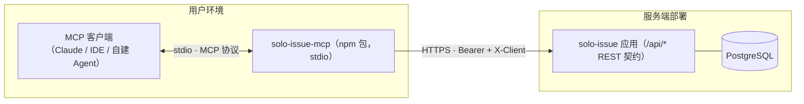
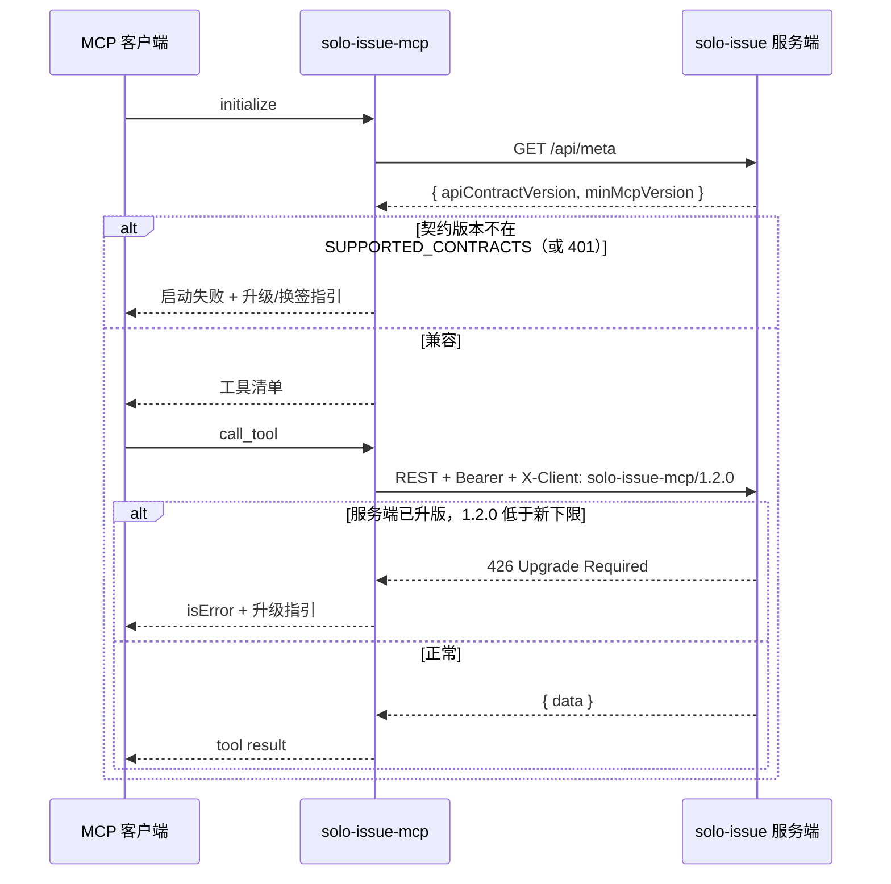

# MCP 适配器设计

> 以 npm 包分发、包裹现有 REST API 的 MCP 服务器设计。配套阅读：Agent 接入工具说明见根 [AGENTS.md](../AGENTS.md)，REST 契约见 [06-api-contract.md](06-api-contract.md)。

## 1. 背景与目标

### 1.1 问题

REST 接入面（Bearer 令牌、scope、错误语义、自描述字段 Schema）已经完备且稳定，但接入门槛偏高：外部 Agent 使用者需要读懂 AGENTS.md、自建 HTTP 客户端、自行处理 422/429 等错误语义，试错成本集中在用户侧。

### 1.2 目标

- Agent 使用者**零代码接入**：`npx solo-issue-mcp` + 两个环境变量（服务地址、令牌）即可在任何 MCP 客户端中使用
- 工具语义与 AGENTS.md 词汇一致，一处的说明两处通用
- 版本兼容有强制保障：用户端 MCP 包与服务端部署版本不兼容时，能得到明确、可操作的提示，而不是不可归因的失败

### 1.3 非目标

- 不做 remote MCP（Streamable HTTP）服务器——留作后续演进，本期只做 stdio 分发
- 不持有任何业务规则：校验、权限、频控单源在服务端，MCP 层不复制、不缓存、不兜底改写
- 不替代 REST 契约：AGENTS.md 与 06-api-contract.md 仍是唯一事实源
- 不映射 Bearer 禁区端点与治理面（`/api/admin/*` 等），令牌能做什么，MCP 工具就只暴露什么

## 2. 总体设计

### 2.1 架构定位：纯透传的协议适配层



三条纪律：

- **零业务逻辑**：MCP 层只做协议转换与请求转发；422/403/429/426 原样透传，LLM 依据结构化错误自修正
- **零凭据持久化**：令牌只从环境变量读入内存，不落盘、不打日志，错误信息不含凭据
- **词汇同源**：工具命名沿用 AGENTS.md 工具清单（search_everything / create_issue / …），描述文案从 AGENTS.md 派生，两处不各自发挥

### 2.2 传输与分发

- 传输：**stdio**（MCP 生态兼容面最广的分发形态）
- 分发：npm 发布 `solo-issue-mcp`（unscoped，安装命令短；发布前查重包名）
- 打包：tsdown 产出 ESM，`bin` 入口；`engines: node >= 20`（比主应用的 `>=22` 放宽一档，扩大适用面）
- 默认拉取策略推荐 `npx -y solo-issue-mcp@latest`，降低版本漂移概率；镜像缓存导致的冻结由第 5 节的服务端强制拒绝兜底

### 2.3 仓库布局（monorepo）

pnpm workspace：主应用在 `apps/web`（部署单位），本包在 `packages/mcp`（分发单位），同仓原子演进：

```text
solo-issue/
├── package.json             # workspace 根：solo-issue-monorepo——仅命令转接，无依赖
├── pnpm-workspace.yaml      # apps/* + packages/*（含构建脚本白名单 onlyBuiltDependencies）
├── apps/
│   └── web/                 # 主应用 solo-issue（Next.js + API + worker，Docker 镜像成员）
│       ├── Dockerfile       # build context = 仓库根（compose 显式指定）
│       ├── scripts/         # dev/verify/ops 全套运维脚本（含 verify-mcp.ts 契约矩阵）
│       └── …                # src / prisma / tests / e2e / 各构建配置
└── packages/
    └── mcp/
        ├── package.json     # name: solo-issue-mcp；bin、engines、dependencies
        ├── tsdown.config.ts
        ├── README.md        # 用户面文档：安装 / 配置 / scope 建议 / 排障
        └── src/
            ├── index.ts     # stdio 入口：配置校验 → 启动自检 → 注册工具
            ├── config.ts    # SOLO_ISSUE_URL / SOLO_ISSUE_TOKEN 读取与 fail-fast
            ├── contract.ts  # SUPPORTED_CONTRACTS 声明与软校验
            ├── http.ts      # fetch 封装：Bearer + X-Client + {data}/{error} 剥壳
            ├── errors.ts    # 状态码 → MCP isError 转译
            └── tools/       # issues.ts / comments.ts / discovery.ts / search.ts
```

### 2.4 备选方案与取舍

| 方案 | 优点 | 弃取原因 |
|---|---|---|
| stdio npm 包（选定） | 兼容面最广，核心零侵入 | 用户需具备 Node 环境（engines 声明 + npx 缓解） |
| 应用内置 remote MCP（Streamable HTTP） | 零安装，只配 URL + token | 核心应用复杂度 +1（长连接/会话管理/运维面扩张），与 01-architecture「MCP 不影响核心」的红线相悖；后续演进可直接复用本设计中的工具定义与版本协商 |
| 独立仓库发布 MCP 包 | 隔离干净 | REST 契约与工具面靠人工跨仓同步，漂移风险高于同仓；同一套验收矩阵（`pnpm verify`）无法把不兼容的改动挡在合并前 |

## 3. 工具面

### 3.1 工具清单与 REST 映射

工具标识沿用 AGENTS.md 词汇；AGENTS.md 的 `discover_context`（一次聚合四个端点）在 MCP 侧拆为细粒度只读工具——MCP 工具参数须静态可声明，拆分后 LLM 可按需组合调用，避免单次返回过载：

| 工具 | REST 端点 | 说明 |
|---|---|---|
| `list_projects` | `GET /api/workspaces/:wsSlug/projects` | 项目列表（含 issue 计数）；`wsSlug` 缺省 `main` |
| `list_states` | `GET /api/projects/:projectId/states` | 状态列表 |
| `list_members` | `GET /api/workspaces/:wsSlug/members` | 成员（assignee 的 userId 来源） |
| `get_fields_schema` | `GET /api/projects/:projectId/fields/schema` | 自定义字段 JSON Schema（写入前必读） |
| `search_everything` | `GET /api/search` | 全局搜索；`filters: { key: value }` 转译为 `cf.<key>=<value>` |
| `list_issues` | `GET /api/projects/:projectId/issues` | 项目内筛选（stateId/assigneeId/q/分页/cf.*） |
| `read_issue` | `GET /api/projects/:projectId/issues/:number` | Issue 详情 |
| `read_history` | `GET /api/projects/:projectId/issues/:number/activities` | 活动流（审计） |
| `create_issue` | `POST /api/projects/:projectId/issues` | `{ title, descriptionText?, stateId?, assigneeIds?, fieldValues? }` |
| `update_issue` | `PATCH /api/projects/:projectId/issues/:number` | 部分更新，多次调用安全 |
| `add_comment` | `POST /api/projects/:projectId/issues/:number/comments` | Tiptap 文档；提及节点 `{ type: "mention", attrs: { id, label } }` |

暂不映射：附件传输、批量更新、保存视图、时间线合并流、治理端——遵循「令牌能做什么才暴露什么」，后续按需增量。

### 3.2 自定义字段的动态契约

MCP 工具 schema 静态声明，而字段定义是项目级、可变的——`fieldValues` 参数声明为宽松对象，配套两条护栏：

1. 工具描述与 422 语义一致地引导：写入前先调 `get_fields_schema`，服务端按定义动态校验（类型/枚举/必填/未知 key → 422 字段明细），LLM 可据明细自修正——兜底始终在服务端
2. schema 由部署服务实时产出，MCP 包内不内置任何字段模板

### 3.3 输出与透传约定

- REST 响应 `{ data }` 剥壳后作为 tool result 返回，原样不裁剪
- 列表默认分页参数沿用服务端缺省（`pageSize=50`、活动流最近 100 条），不放大请求
- `create_issue` 无幂等键：工具描述注明「失败后先 `search_everything` 确认未重复创建再补建」，客户端不自动重试写操作

## 4. 配置与凭据

### 4.1 环境变量

| 变量 | 必填 | 说明 |
|---|---|---|
| `SOLO_ISSUE_URL` | 是 | 部署服务根，含 basePath（默认部署即 `https://issues.example.com/solo-issue`，前缀随部署的 `BASE_PATH`）；包只做空白与尾斜杠规范化，**不自动解析/补写 basePath**——漏配前缀将自检失败（区分脚本内 `verify-agent.ts` 自动补前缀的便利归一化语义，包面对任意部署无从得知前缀） |
| `SOLO_ISSUE_TOKEN` | 是 | `itr_*` 令牌，获取步骤见 §4.2 |

任一缺失 → 启动 fail-fast，输出缺失变量名与获取指引。

### 4.2 令牌获取（用户视角）

签发只能由人类在 Web UI 完成（`/api/api-tokens` 为 Bearer 禁区，Agent 无法自铸自续）：

1. 登录部署实例 → 侧边栏「设置」→「API 令牌」（`/settings/tokens`）
2. 「创建令牌」弹窗：名称必填；scope 多选（`*` 与单项互斥且带警告提示）；有效期 30/90/365 天或永不过期，**缺省 90 天**
3. 创建成功后同一弹窗展示明文 `itr_*` 并提供复制按钮——**仅此一次可见**，任何关闭路径都会清除明文；服务端只存 SHA-256 哈希
4. 后续管理仅剩改名与撤销；scope 与有效期签发后不可改——**轮换 = 撤旧建新**

两条语义 README 必须原样传达：

- **权限 = scope ∩ 所属用户角色**：GUEST 账号签发的令牌写操作依旧 403——为 bot 建号时角色需同步给足
- **明文再现的唯一途径是重新签发**：丢失即撤销重建，不存在找回

### 4.3 客户端配置样例

```json
{
  "mcpServers": {
    "solo-issue": {
      "command": "npx",
      "args": ["-y", "solo-issue-mcp@latest"],
      "env": {
        "SOLO_ISSUE_URL": "https://issues.example.com/solo-issue",
        "SOLO_ISSUE_TOKEN": "itr_xxx"
      }
    }
  }
}
```

这是所有主流客户端（Claude Desktop / Claude Code / Cursor 等）共用的骨架——stdio 服务器统一为 `command + args + env`，客户端按服务器名给工具做命名空间隔离。各客户端的配置文件位置、Windows 的 `cmd /c npx` 变体、项目级配置（`.mcp.json`）的令牌防泄漏警告与逐步指引，由 `packages/mcp/README.md` 单源承载。Claude Code 另有可直接打开的示范配置项目 [packages/agent-mcp-demo](../packages/agent-mcp-demo)——目录内含项目级 `.mcp.json`（令牌留空模板，指向本仓库包的构建产物）与逐步指引。

### 4.4 多部署连接

令牌与部署天然成对：每个 solo-issue 部署有独立的用户库，令牌互不通用；`URL + TOKEN` 绑定在同一实例配置内，结构上不存在错配通道。同一用户对接多个部署的推荐形态是**多个命名实例**（MCP 客户端原生能力，零代码改动）：

```json
{
  "mcpServers": {
    "solo-work": {
      "command": "npx", "args": ["-y", "solo-issue-mcp@latest"],
      "env": { "SOLO_ISSUE_URL": "https://issues.corp.com/solo-issue", "SOLO_ISSUE_TOKEN": "itr_aaa" }
    },
    "solo-personal": {
      "command": "npx", "args": ["-y", "solo-issue-mcp@latest"],
      "env": { "SOLO_ISSUE_URL": "http://localhost:8081/solo-issue", "SOLO_ISSUE_TOKEN": "itr_bbb" }
    }
  }
}
```

该形态同时兑现四件事：

- **版本协商独立**：每个实例 initialize 只与自己的部署协商，公司已升级/个人还旧版互不干扰（§5 双重保障按实例生效）
- **频控独立**：频控边界与令牌边界天然对齐
- **「一个部署 + 双身份」同形态覆盖**：同一 URL 配人与 bot 两个令牌、各开一个实例
- **工具不串扰**：客户端按实例名隔离工具（如 `mcp__solo-work__create_issue`）

配套三条使用纪律（README 承载）：实例名要可区分（`solo-work`，不要 `solo-issue-2`）；优先用项目级配置圈定作用域——公司仓库的 `.mcp.json` 只注册工作部署，其他环境根本不出现这套工具；多实例意味着多份工具 schema 进上下文，不常用的部署按需启停。

否决过的替代方案：包内做多 target 路由（单实例接受多组 URL/TOKEN，每工具加 `target` 参数）——启动自检需同时与 N 个部署协商且部分失败语义复杂化、包内引入多份连接状态、每工具多一层参数，违背纯透传纪律（§2.1），无相称收益。

### 4.5 令牌纪律与 scope 推荐

README 面向用户写死四条纪律：专用机器人用户（`apps/web/scripts/ops-add-user.ts`）、最小 scope、限期令牌、禁用 `*`。令牌权限 = scope ∩ 所属用户角色，角色不足（如 GUEST 只读）MCP 无法绕开，也不尝试绕开。

| 用途 | 推荐 scope |
|---|---|
| 巡检/只读 | `projects:read` `fields:read` `issues:read` `comments:read` `search:read` |
| 可写操作 | 巡检集 + `issues:write` `comments:write` |
| 字段定义维护 | 可写集 + `fields:write`（需项目负责人角色） |

## 5. 版本兼容：契约版本 + 双重保障

> 消费对象是 **REST 契约版本**（路由/scope/错误语义/fields schema 结构），不是应用版本号 0.x。兼容判定的权威在服务端：客户端声明支持范围（启动自检），服务端保留最终拒绝权（强制 426）。

### 5.1 契约版本单源

```ts
// apps/web/src/lib/api-contract.ts —— 契约版本与 MCP 兼容下限的单一事实源
export const API_CONTRACT_VERSION = 1 as const;
export const MIN_MCP_VERSION = "0.0.1" as const;
```

| 变更类型 | 例子 | 动作 |
|---|---|---|
| 破坏性 | 删/改路由、scope 语义、错误语义、`fields/schema` 结构 | `API_CONTRACT_VERSION++`，同步提升 `MIN_MCP_VERSION` |
| 兼容 | 新增路由/scope、响应加字段、枚举扩充 | 不动契约版本 |

### 5.2 服务端设施（强制面）

- **`GET /api/meta`**（新增一条路由，进 06 契约表）：返回 `{ version, apiContractVersion, minMcpVersion }`，Bearer/会话双通道可用
- **`X-Client` 头判定**（收口在 `apps/web/src/server/auth/token.ts` 既有鉴权链内，无全局中间件）：请求头形如 `solo-issue-mcp/1.2.0` 且版本低于 `MIN_MCP_VERSION` → `426`，错误体携带需升级到的版本；无该头的调用方（脚本/自建 Agent）不受影响
- 426 进错误语义表（06 §1 与 AGENTS.md §3），文案走既有 i18n，断言以状态码为准

### 5.3 MCP 端启动自检（提前失败面）

MCP 包内嵌 `SUPPORTED_CONTRACTS: number[]`；`initialize` 时先调 `/api/meta`：契约版本不在支持范围 → 拒绝启动并输出升级命令（`npx -y solo-issue-mcp@latest`）；令牌无效（401）→ 拒绝启动并提示重新签发。把配置错误截在第一次会话，而非使用中途。

### 5.4 协商流程



### 5.5 发布纪律

- **版本窗口**：服务端每个契约版本至少保持对此前两个 minor 周期的 MCP 包向后兼容（n-2 窗口），收敛动作随大版本发布说明公告
- **单 PR 原子变更**：契约破坏性变更必须在同一提交里完成——服务端 `api-contract.ts`、AGENTS.md、MCP 支持范围、验收脚本——不出现「服务先行、包掉队」的中间态
- **验收契约矩阵**：`pnpm verify` 中的 verify-mcp（`apps/web/scripts/verify-mcp.ts`）经 MCP 层驱动全工具面，不兼容的组合最坏也无法合并；发布产物记录服务端 tag ↔ MCP 版本映射（尚无外部 CI runner，合并前须本地跑全量验收）
- 包版本遵循语义化版本：契约大版本升 → MCP 主版本升

## 6. 错误语义透传

### 6.1 状态码映射

| 状态码 | REST 语义 | MCP 转译 |
|---|---|---|
| 401 | 令牌无效/过期/撤销 | isError + 提醒人工重新签发 |
| 403 | scope 不足 / 角色不足 / 禁区 | 透传 error 文案（含缺失 scope 名），不重试 |
| 404 | 不存在或无权可见 | 按不存在处理，不重试 |
| 422 | 参数校验失败 | **保留字段明细**，LLM 据此自修正后重试 |
| 429 | 令牌频控 | 透传 `Retry-After`，提示降低调用频率 |
| 426 | MCP 版本低于服务端下限 | 升级指引：`npx solo-issue-mcp@latest` |
| 5xx | 服务端错误 | 指数退避重试 ≤3 次（仅读操作） |

### 6.2 重试与幂等

- 读操作幂等可安全重试；写操作不自动重试——`update_issue` 本身部分更新语义可重试，`create_issue` 失败后先 `search_everything` 确认再补建（无幂等键，重试可能重复建单）
- 通知回路说明：指派/@提及/状态变更/评论的站内与 IM 通知由服务端自动发出，MCP 层与用户皆无需关心

## 7. 实施与发布状态

实现侧已落地：`packages/mcp` 全量实现（工具面、启动自检、错误透传、单测），verify-mcp 契约矩阵纳入 `pnpm verify`；配套文档影响面均已合入（AGENTS.md 的 426 错误行与 MCP 接入段、06 的 `/api/meta` 与错误语义、10-testing 的验收矩阵分层说明、01 §6 的已实现声明、`packages/mcp/README.md` 用户面文档）。

待执行：npm 发布——发布前 `npx -y solo-issue-mcp@latest` 拉取不可用，本地联调以仓库构建产物为准；发布时按 §5.5 单 PR 原子变更补充根 README 的 MCP 快速入口。

## 8. 风险与缓解

| 风险 | 等级 | 缓解（对应设计落点） |
|---|---|---|
| 发布即契约稳定性承诺：REST API 变成事实公共 API | 高 | 契约版本单源与定级表（§5.1）；破坏性修订克制 |
| 版本漂移：用户长期不升级 MCP 包 | 高 | 双重保障（§5.2/5.3）+ `npx@latest` + n-2 窗口（§5.5） |
| fields schema 动态、工具 schema 静态的结构性错配 | 中 | 先读 schema 引导 + 服务端 422 兜底（§3.2） |
| `create_issue` 无幂等键叠加客户端重试 → 重复建单 | 中 | 不自动重试写操作 + 先 search 后补建（§3.3/6.2）；根治需服务端幂等键，另立项 |
| 令牌暴露面扩大（明文进各客户端配置文件，项目级配置有入库风险） | 中 | 最小 scope / 专用用户 / 限期纪律写进 README（§4.2/4.5）；项目级配置防泄漏警告 + token 留空模板（§4.3） |
| 多实例并存时 LLM 误选部署 | 低 | 实例名可区分 + 项目级配置圈定作用域 + 按需启停（§4.4） |
| 三处同步成本（代码/AGENTS.md/MCP 描述） | 中 | 词汇同源 + 验收契约矩阵（§2.1/5.5） |
| 目标环境无 Node | 低 | `engines` 声明 + npx 前置说明；后续演进 remote MCP（§2.4） |
| remote MCP 演进重叠 | 低 | 工具定义与版本协商独立成模块，双形态复用（§2.4） |
