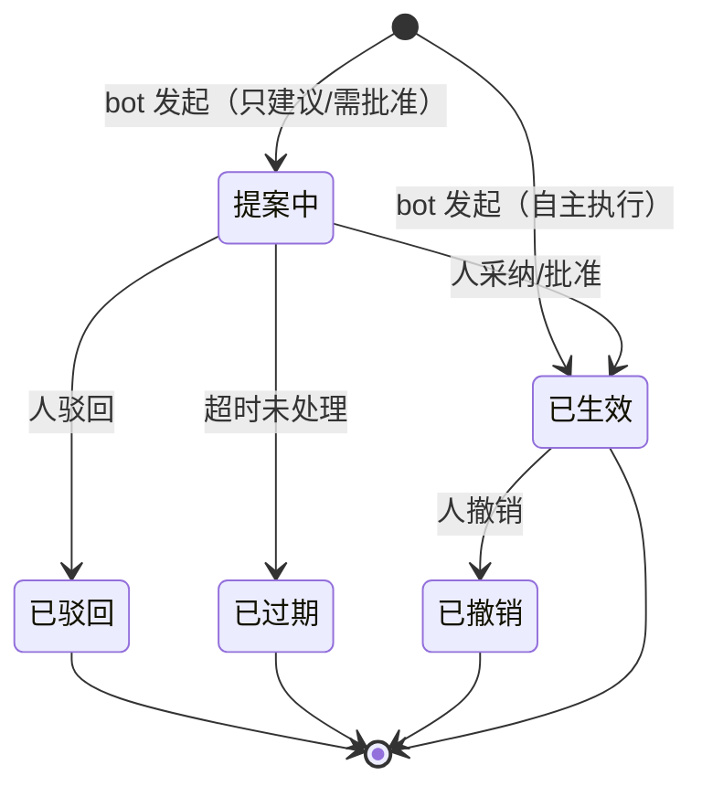
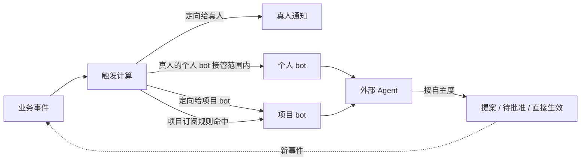
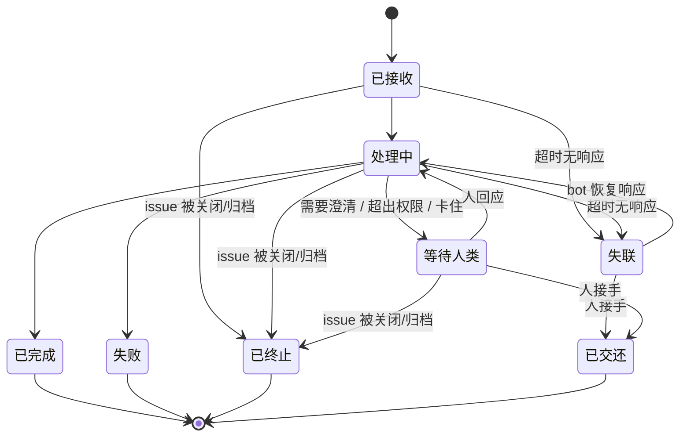

# R01 RFC：人机共生——个人 Bot 与项目 Bot

> 状态：**需求层定稿（v1，2026-10-09）**。20 条已定决策（D1–D20，见 §10）；实现设计另行成文，勿直接按本文实施。

## 目录

1. [背景与动机](#1-背景与动机)
2. [需求](#2-需求)
   - [2.1 目标](#21-目标)
   - [2.2 非目标](#22-非目标)
3. [共生原则](#3-共生原则)
4. [两种关系 代理与同事](#4-两种关系-代理与同事)
   - [4.1 个人 Bot](#41-个人-bot)
   - [4.2 项目 Bot](#42-项目-bot)
5. [自主度分级](#5-自主度分级)
   - [5.1 档位与设定](#51-档位与设定)
   - [5.2 提案可见性](#52-提案可见性)
   - [5.3 撤销语义](#53-撤销语义)
6. [触发与接入](#6-触发与接入)
   - [6.1 触发面](#61-触发面)
   - [6.2 接入方式](#62-接入方式)
   - [6.3 投递约束](#63-投递约束)
7. [Bot 工作状态与交接](#7-bot-工作状态与交接)
8. [协作体验](#8-协作体验)
9. [安全与治理约束](#9-安全与治理约束)
10. [已定决策](#10-已定决策)

## 1. 背景与动机

一般的 issue 系统把 AI 当作"集成"来对待：发个令牌，调调 API，在界面上看不见，也说不清责任。本产品的差异化定位是**人机共生**：bot 是协作关系里看得见、可问责、能逐步获得信任的参与者，不是藏在后台的脚本。

一句话需求：

- **每个人都可以配置并接入自己的 bot**，让它代替自己处理工作；
- **每个项目都可以有 bot 参与**，像团队成员一样被指派、被 @，并主动承担项目里的例行工作。

本 RFC 只定义需求与原则，不受现有实现约束；实现设计在需求定稿后另行展开。

## 2. 需求

### 2.1 目标

1. **个人 Bot**：任何成员都能自助接入一个或多个属于自己的 bot，由它代为处理自己收到的工作。
2. **项目 Bot**：任何项目都可以添加 bot 作为项目参与者，可以被指派、被 @，也能按项目规则主动介入。
3. **透明可信**：所有 bot 动作对协作者可见、可追溯、可撤销，每个 bot 都有可问责的人。
4. **渐进放权**：人按动作类别为 bot 设定自主度，随着信任积累逐步放权。
5. **事件驱动**：bot 在相关事件发生时被系统主动触发，不需要人工转述。
6. **低门槛接入**：没有公网地址的 bot（比如跑在个人电脑上的 agent）也能接入。

### 2.2 非目标

- 不内置 Agent 运行时：bot 的"大脑"运行在系统外部，系统只负责身份、权限、触发、呈现和治理。
- 不做实时承诺：bot 与真人一样，接受秒级到分钟级的延迟。
- 不改变真人成员现有的通知体验，bot 相关的提示是增量。

## 3. 共生原则

以下原则优先于后续章节的所有具体需求。如有冲突，以原则为准。

| 原则 | 含义 | 反例（禁止） |
|---|---|---|
| 透明署名 | 机器做的事必须看得出是机器做的，并且能看出代表谁 | 个人 bot 以主人名义静默改动，他人以为是本人所为 |
| 人兜底 | 每个 bot 都有一个可问责的人：个人 bot 是主人，项目 bot 是项目负责人 | 出了问题找不到负责人的"孤儿 bot" |
| 权限不越级 | bot 的有效权限不超过其**身份载体**的角色天花板，单次授予不超过授予人**当时**的权限 | 通过 bot 绕过角色或可见性限制 |
| 渐进放权 | 自主度由人设定，可随时收回 | bot 默认拥有全部自主权 |
| 审批归人 | 批准、驳回只能由人完成；bot 不能批准 bot，个人 bot 不能代主人批准 | 自主执行档的个人 bot 替主人批准提案，"需批准"档形同虚设 |
| 可交接 | bot 能明确把工作交还给人，交接是一等事件 | bot 卡住后沉默，任务悬空 |
| 可撤销 | bot 自主执行的动作可以由人回滚 | 不可逆的自动化改动 |

## 4. 两种关系 代理与同事

两种 bot 的区别在于**协作关系**，不在于部署位置。

| 维度 | 个人 Bot（代理） | 项目 Bot（同事） |
|---|---|---|
| 关系定位 | 替我干活 | 团队的一员 |
| 身份呈现 | 依附于主人："张三 · 经由 助手名" | 独立身份："Triage 机器人" |
| 身份载体 | 主人名下的代理凭证，无成员关系 | 项目成员（带 bot 标识），复用现有角色矩阵 |
| 添加者 | 主人本人，自助配置 | 项目负责人 |
| 责任人 | 主人 | 项目负责人 |
| 权限上限 | 主人权限的子集（按工作区取交集） | 项目授予的权限，以项目角色权限为上限 |
| 触发来源 | 主人收到的事件 | 指派/@ 它的事件，以及项目订阅规则 |
| 能否被指派 | 不占负责人位，issue 仍归主人 | 可以，与真人同等出现在选择器中 |
| 生命周期 | 主人停用或离开时随之失效 | 不受普通成员进出影响，随项目存续 |

### 4.1 个人 Bot

1. **自助接入**：成员在个人设置中接入自己的 bot，无需管理员审批（见 [10](#10-已定决策)）。
2. **代理语义**：个人 bot 代表主人行事，处理的是主人的工作，issue 的归属和负责人不变。
3. **可见**：代理动作对所有能看到该 issue 的协作者可见，署名形如"张三 · 经由 助手名"。其他人能区分本人操作和代理操作。未采纳的提案不属于动作，默认仅主人可见（见 [5.2](#52-提案可见性)）。
4. **权限收窄**：主人可以在自身权限范围内进一步限制 bot，比如只读、只评论、只在某些项目生效。
5. **多 bot 与路由**：每人可接入多个个人 bot，需求层面不设上限（实例可配软上限）。事件按"项目 × 事件类型"的路由规则分发，规则自上而下匹配，同一事件默认只交给一个 bot，避免重复劳动和动作冲突。
6. **默认范围**：至多一个 bot 占据**默认接管"被指派"**位——首个接入的 bot 自动占据，主人可在 bot 间转移该位；未占位的 bot 默认不接管任何事件，由主人配置路由。配合"只建议"默认档与提案私有，默认接管不会打扰他人。
7. **手动委派**：主人可以在任意 issue 上"交给 bot X"，不依赖路由规则。

### 4.2 项目 Bot

1. **就近归属**：项目负责人为项目注册 bot、设定其权限与自主度，并对它**全权负责**——不论是协作内的问题（交接、待批准）还是 bot 本身的问题（失联、故障、端点失效），都找项目负责人。负责人变更时，bot 随项目管理权自然移交，不会出现无人负责的 bot。
2. **同事语义**：项目 bot 是项目的正式参与者，可以被指派为负责人、被 @，出现在成员选择器中，并带有明确的 bot 标识。它以**项目成员**身份存在：负责人注册即建立项目成员关系，默认角色 MEMBER，负责人可下调为只读（对应现有 GUEST 语义）；权限复用现有角色矩阵，不设 bot 专属角色。
3. **主动介入**：除了被点名，项目 bot 还能按项目订阅规则主动工作，例如新 issue 自动分诊、查重、补全字段，或状态进入"验证"时自动检查。
4. **项目内可见性**：项目 bot 只能看到其所在项目的内容，私有项目的可见性规则对它同样生效。
5. **跨项目复用**：不建共享模型。bot 在系统内只是一份身份与配置记录，同一个外部 agent 进程可以在多个项目各注册一个 bot 身份、各持独立凭证——复用发生在外部进程层面，系统不需要为此增加任何机制。将来若出现真实的共享需求，"工作区目录"可作为后续增强叠加，不改动本模型。

## 5. 自主度分级

自主度是"共生"区别于"集成"的核心机制：人决定 bot 在每类动作上能走多远。

### 5.1 档位与设定

| 档位 | 行为 | 适用场景 |
|---|---|---|
| 只建议 | bot 产出评论或变更提案，由人一键采纳或驳回 | 新接入、低信任期 |
| 需批准 | bot 发起动作，进入待批准状态，经人确认后生效 | 影响较大的动作，如关闭 issue、改负责人 |
| 自主执行 | 动作直接生效，留痕并可撤销 | 已建立信任的例行动作，如补全字段、就分诊结论自动回复 |

需求约束：

- 自主度按**动作类别**设定（类别清单以 [9](#9-安全与治理约束)「授权面」为唯一事实源），不是一个总开关。
- 个人 bot 的自主度由主人设定，项目 bot 的由项目负责人设定。
- 新接入的 bot 默认处于"只建议"档。
- 动作类别若属**负面清单**（见 [9](#9-安全与治理约束)），自主度档位对它一律不生效。
- 待批准动作有**默认审批人**（个人 bot = 主人；项目 bot = 项目负责人）和过期时间，超时提醒发给默认审批人；具备对应动作权限的其他成员也可代为批准。审批只能由人完成（见 [3](#3-共生原则)「审批归人」）。
- 放权由责任人手动配置。基于采纳率的放权建议列为后续增强，不在本期范围。

### 5.2 提案可见性

- 个人 bot 的提案默认仅主人可见，相当于私人草稿；主人采纳后，以"主人 · 经由 bot"的署名公开生效。
- 未采纳的提案没有改变任何协作状态，不属于"动作"，因此不违反透明署名（D1）。
- 项目 bot 的提案对能看到该 issue 的成员公开；任何具备对应动作权限的项目成员都可采纳（见 [10](#10-已定决策) D12）。
- 待批准动作与提案同属未生效的非动作：个人 bot 的待批准动作同样仅主人可见（默认审批人即主人），项目 bot 的待批准动作对能看到该 issue 的成员公开。

### 5.3 撤销语义

- **范围**：系统只保证系统内动作可撤销（授权面内可撤销的动作本身，如改状态、改字段、隐藏评论；类别清单见 [9](#9-安全与治理约束)「授权面」）。bot 在系统外产生的副作用由 bot 自身负责。
- **补偿而非抹除**：撤销记为一条新活动，原动作保留并标记"已撤销"。
- **无时间窗口**：系统内撤销随时可做；若同一字段此后被人修改过，撤销跳过该字段并提示冲突，不覆盖人的修改。
- **通知更正**：已发出的通知无法收回，撤销时向原接收人补发更正提示。
- **批量撤销**：支持按 bot 和时间范围批量撤销（如"撤销 bot X 过去 2 小时的全部动作"），与紧急制动配套用于事故处置。
- **撤销权**：对齐被撤销动作本身的权限——能做该动作的人即可撤销。bot 只能撤销**自己的**动作，且该类别须处于"自主执行"档；撤销他人动作、批量撤销仅限人（负面清单，见 [9](#9-安全与治理约束)）。

## 6. 触发与接入

### 6.1 触发面

| 触发类型 | 个人 Bot | 项目 Bot |
|---|---|---|
| 定向事件 | 主人被指派、被 @、关注的 issue 变更 | 自身被指派、被 @、自身负责的 issue 变更 |
| 订阅事件 | 不适用 | 项目级规则命中，如新建 issue、状态进入某阶段、字段值命中 |
| 交接回应 | 主人对 bot 交接的回复 | 项目负责人（具备权限的成员亦可）对 bot 交接的回复 |

### 6.2 接入方式

"每个人都能接入自己的 bot"意味着大量 bot 没有公网地址，所以系统必须同时支持两种接入方式：

1. **推送**：系统把事件推送到 bot 登记的外部端点，适合有服务端部署的 bot。
2. **拉取**：bot 主动连接系统领取事件（长连接或长轮询），适合本地运行的 agent，无需公网地址。

两种方式的事件语义一致，接入方可以随时切换。

### 6.3 投递约束

- **信封薄、明细拉**：事件只携带最小描述与定位符，明细由 bot 通过读 API 获取。系统不维护第二份业务信息契约。
- **至少一次投递**：允许重复，每个事件有稳定 id 供去重。
- **身份可信**：推送的事件可被 bot 验证来源、防篡改、防重放；bot 回写使用自己的凭证。
- **事件可解释**：事件标明触发原因（被指派 / 被 @ / 订阅规则 X 命中），bot 能区分不同的触发场景。

## 7. Bot 工作状态与交接

人把工作交给 bot 后，必须能看到它在做什么。每个 bot 对每个接手的 issue 都有可见的工作状态：

需求约束：

- 工作状态在 issue 详情可见，"等待人类"的 issue 会出现在责任人的待办中。
- **交接**是一等事件：bot 必须说明交接原因和已完成的部分，并定向通知责任人。
- bot 长时间无响应时，系统自动将其标记为失联并通知责任人，不让任务悬空。
- 订阅触发的批量例行工作（如新 issue 分诊）允许折叠为按 bot 的汇总状态，不在每个 issue 上独立展开，避免状态位本身成为噪声。
- 目标 issue 被人关闭或归档时，bot 在该 issue 上的工作状态转入**已终止**；「失败」与「已终止」同样通知责任人，不让任务悬空。

## 8. 协作体验

1. **署名**：所有 bot 动作带有 bot 标识。代理动作显示"主人 · 经由 bot"，同事动作显示 bot 自己的身份。
2. **噪声控制**：bot 的产出量远大于人。活动流和通知对 bot 动作做**呈现层**的消化——超出常规量的内容自动折叠或默认隐藏，展开仍可见——只影响人看到的信息密度，不限制 bot 的产出本身（系统不做频控，见 [9](#9-安全与治理约束)）；折叠阈值实现时再定。
3. **统一入口**：每个人都能在一个地方看到"我的 bot 们"在做什么，以及"等我批准/回应"的事项。
4. **人可随时介入**：人可以暂停某个 bot、收回自主度，或者在某个 issue 上叫停 bot。

## 9. 安全与治理约束

- **权限不越级（个人 bot）**：有效权限 = 授予权限 ∩ 主人在相应工作区的权限。主人可能在多个工作区持有不同角色，按工作区分别取交集；主人权限降低时，bot 立即随之降低。
- **权限不越级（项目 bot）**：以项目授予的权限为上限，与负责人的工作区角色无关；负责人变更时，bot 随管理权移交而非权限降级。
- **授权面**：每个 bot 的授权面 = 动作类别授予（读 / 评论 / 改状态 / 改字段 / 改指派 / 关闭 / 归档）+ 读范围 + 每类别的自主度档位。**触发计算与 API 回写共用同一份授权面**：事件先经授权面过滤再投递，bot 回写按同一授权面校验——不允许"事件发过去但权限够不着"，也不允许"触发被裁剪了但 API 还摸得着"。
- **读范围**：个人 bot = 主人可见范围；项目 bot = 本项目。订阅类工作（查重、分诊）要求全项目读，属正常授予。
- **双层上限**：有效权限 = 动作类别授予 ∩ 角色天花板。个人 bot 无成员身份，是主人名下的代理凭证，天花板 = 主人在相应工作区的角色；项目 bot 是项目成员，天花板 = 自身项目角色。
- **授予时点封顶**：授予是否合法以**授予那一刻**授予人的权限为准（个人 bot ∩ 主人、项目 bot ⊆ 负责人当时的项目角色）；此后交给联动规则——个人 bot 实时随主人、项目 bot 随管理权移交（见上文「权限不越级」）。
- **矩阵照用，不做特判**：现有权限矩阵对 bot 全部照用——不因"是 bot"而加规则，也不豁免。GUEST 主人的个人 bot 自然只读，摘要、盯变更类用途依然成立。
- **负面清单**：以下动作无论自主度档位如何**永不授予 bot**——权限面（成员与角色管理、bot 自身的配置与自主度变更）、凭证面（API 令牌管理）、治权（审批他人动作、撤销他人动作、批量撤销）。负面清单与自主度互不解救。
- **收窄的在途处置**：权限收窄即时生效。未生效的提案/待批准动作自动作废并通知默认审批人；已生效动作不动，撤销与否由人判断；工作状态"处理中"的 bot 可完成当前步骤，但不得再发起新动作，回写超权即被拒绝并触发一次交接。
- **频控不入系统**：系统不为 bot 设频控与用量配额，节流由外部 bot 自行处理；防回环的因果链跳数上限与熔断属回环防护，不受此限。
- **生命周期联动**：个人 bot 随主人停用而失效。项目负责人变更时，项目 bot 随项目管理权自然移交。
- **防回环**：bot 不被自己的动作触发。bot 之间的连锁触发计入同一条因果链，跳数上限对整条链生效（不按 bot 各自计算），并辅以频率熔断；触发链在 issue 上可见。
- **出站地址策略**：推送端点由使用者自助配置，实例层面只设出站策略作为护栏（例如禁止内网地址、可选域名白名单），不做逐个审批。
- **紧急制动**：实例管理员可停用任意 bot，项目负责人可停用其项目内的 bot，主人可停用自己的个人 bot；均支持按范围一键停用（某个 bot、某人或某项目的全部 bot）。
- **审计**：所有 bot 动作、提案、批准、撤销、交接都可追溯到 bot、责任人和触发事件。

## 10. 已定决策

| 编号 | 问题 | 决策 |
|---|---|---|
| D1 | 个人 bot 的代理动作是否对他人可见 | 可见，署名为"主人 · 经由 bot" |
| D2 | 自主度分级是否为核心需求 | 是，纳入本 RFC 范围 |
| D3 | 个人 bot 的配置门槛 | 在主人权限范围内自助配置，无需审批 |
| D4 | 项目 bot 由谁添加并负责 | 项目负责人（全权负责，负责人变更时随之移交） |
| D5 | 个人 bot 未采纳提案的可见性 | 默认仅主人可见，采纳后以"主人 · 经由 bot"公开 |
| D6 | 审批主体 | 只能由人完成，提升为共生原则「审批归人」 |
| D7 | 撤销语义 | 补偿动作；系统内无时间窗口；遇人工修改跳过并提示冲突 |
| D8 | 个人 bot 默认事件范围 | 至多一个 bot 占据"默认接管被指派"位：首个接入时自动占据，主人可在 bot 间转移；未占位的 bot 默认不接管任何事件 |
| D9 | 放权方式 | 前期由责任人手动配置；采纳率驱动的放权建议列为后续增强 |
| D10 | 项目 bot 归属模型 | 就近归属：项目负责人注册并全权负责；跨项目复用由外部 agent 进程多注册实现，不建共享模型，不引入维护者/监护人双角色 |
| D11 | 个人 bot 触达项目 bot | 允许 @ 与指派，无需单独授权，视为主人发起 |
| D12 | 项目 bot 提案的采纳人 | 任何具备对应动作权限的项目成员；个人 bot 的提案仅主人可采纳（见 D5） |
| D13 | 频控与用量配额 | 系统不做频控与配额，节流由外部 bot 自行处理（防回环熔断除外） |
| D14 | 授权模型 | 授权面三元组：动作类别授予 × 读范围 × 自主度档位；触发计算与 API 回写共用同一份授权面 |
| D15 | 负面清单 | 权限面 / 凭证面 / 治权三类动作永不授予 bot，与自主度档位互不解救 |
| D16 | 权限边界细节 | 未生效动作的可见性沿用 D5 逻辑（个人 bot 仅主人）；撤销权对齐被撤动作的权限，bot 只能撤销自己且须"自主执行"档；收窄即时生效：未生效作废、已生效不动、处理中不得新发起 |
| D17 | 权限上限结构 | 双层：有效权限 = 动作类别授予 ∩ 角色天花板（个人 bot 天花板 = 主人角色；项目 bot = 自身项目角色） |
| D18 | 项目 bot 身份载体 | 以项目成员身份存在（带 bot 标识），默认角色 MEMBER，可下调为只读（GUEST 语义）；复用现有角色矩阵，不设 bot 专属角色 |
| D19 | 只读场景 | 权限矩阵对 bot 不做特判；GUEST 主人的个人 bot 自然只读，摘要类用途成立 |
| D20 | 授予时点封顶 | 授予合法性以授予时点授予人的权限为准，此后靠联动规则（个人实时、项目移交） |

开放问题已全部定夺，需求层就此定稿；实现设计另行成文。
