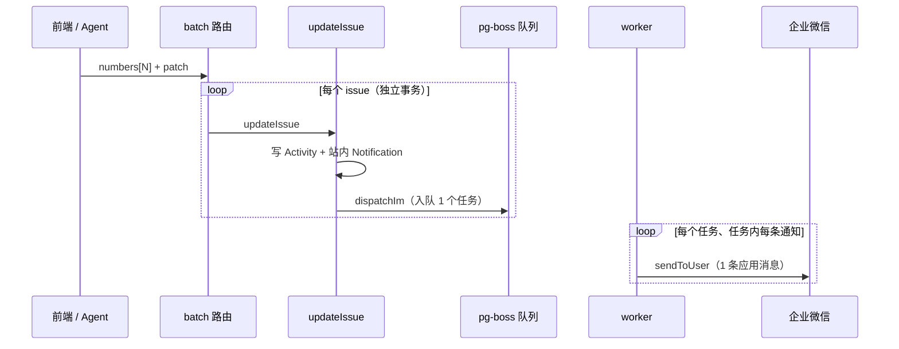

# S01 批量操作导致企微通知刷屏

> 状态：待处理（不阻塞 0.0.1 内测）｜严重度：中｜记录日期：2026-10-23

## 1. 现象

在列表页批量修改状态或指派人（`POST /api/projects/:projectId/issues/batch`，单次最多 100 条，见 `apps/web/src/lib/validations.ts:288`）时，每个 issue 各自触发一轮通知。同一个人如果是这批 issue 的指派人或创建人，会在企业微信里连续收到与 issue 数量相同的应用消息。

## 2. 根因

- `batchUpdateIssues`（`apps/web/src/server/services/issue.ts:655`）逐条调用 `updateIssue`，每条独立事务，部分失败不影响已成功项。
- `updateIssue` 在事务提交后调用 `dispatchIm(notificationIds)`（`issue.ts:621`），每个 issue 入队一个 IM 推送任务（`apps/web/src/server/services/notification.ts:170`）。
- worker 的 `processImSend`（`apps/web/src/server/services/im-send.ts:13`）对任务内每条通知调用一次 `channel.sendToUser`（`im-send.ts:57`），不按接收人合并。
- 推送策略在 `docs/01-architecture.md` §4.4 定为"即时发送，不做攒批"。这对单条编辑合理，但批量路径没有区别处理。

## 3. 影响

接收人规则依据 `docs/01-architecture.md` §4.4 的通知计划：

| 操作 | 接收人（均排除操作者） | 每人收到的企微消息数 |
|---|---|---|
| 批量改状态，N 条 | 每条 issue 的指派人 ∪ 创建人 | 最多 N 条 |
| 批量把指派人改为 A，N 条 | A（A 原本不是指派人的那些 issue） | 最多 N 条 |

站内通知中心同样写入 N 条，但站内是列表展示、可按类型筛选，干扰远小于 IM 推送。本问题只处理 IM 推送。

## 4. 处理方案

### 4.1 方案 A：批量路径按接收人合并 IM 推送（推荐）

- `updateIssue` 增加可选参数：批量路径调用时不立即 `dispatchIm`，改为把 `notificationIds` 返回给调用方；
- `batchUpdateIssues` 汇总全部成功项的通知 id，循环结束后只调用一次 `dispatchIm`，payload 带批量标记（如 `batch: { actorId, projectId }`）；
- `processImSend` 识别批量标记：先做偏好过滤，再按 `userId` 分组；组内只有 1 条时照常发送，多于 1 条时发一条汇总消息（如"{操作者} 批量更新了 {n} 个 issue"，链接到项目列表页）；
- 站内通知与 Activity 保持逐条写入，审计和时间线不受影响。

改动集中在 `issue.ts`、`notification.ts`、`im-send.ts` 三个文件，不改 schema。

### 4.2 方案 B：全局攒批（时间窗口合并）

对所有 IM 推送按接收人做时间窗口合并，能同时覆盖"短时间内连续单条编辑"的场景，但要引入延迟发送和窗口状态。它属于 `docs/01-architecture.md` §6 已列出的"通知聚合"后续方向，范围超出本问题。

## 5. 验收标准

- 集成测试：批量把 10 个 issue（指派人均为用户 A）改到另一状态 → A 有 10 条站内通知；IM 通道对 A 只调用 1 次 `sendToUser`，内容为汇总消息。
- 集成测试：批量操作只命中 1 条 issue 时，IM 消息与单条编辑一致。
- 偏好过滤（`NotificationPreference(type).wecom=false`）在汇总前生效，被过滤的通知不计入汇总条数。
- `docs/01-architecture.md` §4.4 同步更新推送策略描述。
- `pnpm test:coverage` 全绿。

## 6. 待定问题

- 汇总阈值：多于 1 条即合并，还是达到一定数量才合并。
- 同一批次里一个人同时收到 `ASSIGNED` 和 `STATE_CHANGED` 时，合并为一条还是按类型各发一条。
- 汇总消息的链接目标：项目列表页，还是只显示本次涉及 issue 的视图（列表接口目前没有按编号集合过滤的参数，见 `docs/06-api-contract.md` §6）。
