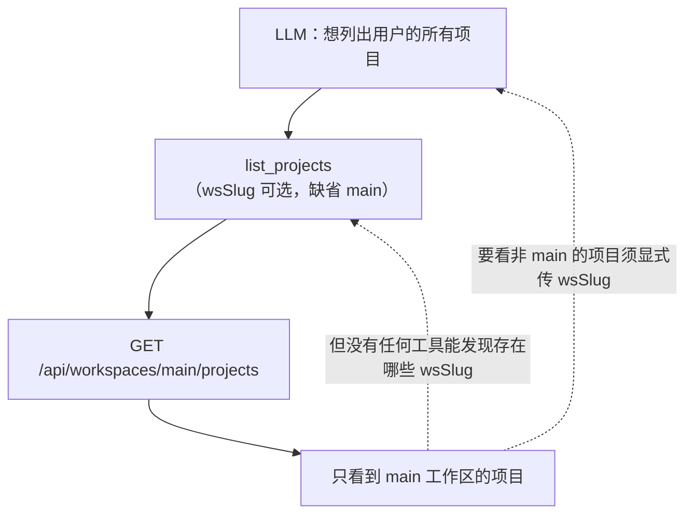
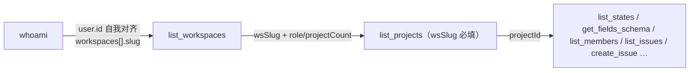

# S05 MCP Agent 身份盲区与跨工作区发现缺口

> 状态：已处理（2026-10-30 实施并通过全量验收：verify-agent 45/45、verify-mcp 34/34、集成/单测 279 过）｜严重度：中（仅 Agent 接入面，REST 既有能力与安全基线不受影响）｜记录日期：2026-10-30

## 1. 现象

Agent（MCP 包或裸调 REST）使用方反馈三件事，全部指向 Agent 面缺少"自我与工作区"的发现能力：

- 分不清"当前的我"是谁：无法把工具返回的 userId 与令牌归属用户对齐，@提及、指派归因只能靠猜；
- 拿不到"我在哪几个工作区"：没有可用的枚举入口；
- 跨工作区找不到项目：非 main 工作区的项目对 Agent 完全不可见。

## 2. 根因分析

三个症状根因不同：一个是端点真空，两个是"服务端能力已有、Agent 面没接上"。

### 2.1 身份：Bearer 可达面没有身份回吐端点

功能上完全对口的是 `GET /api/auth/me`（user 画像 + 所属工作区），但整个 `/api/auth/` 前缀在 Bearer 禁区（`apps/web/src/server/auth/token.ts:50-57`），命中即 403（`:169-171`）；`apps/web/scripts/verify-agent.ts:266-267` 把这条 403 当安全负例断言。唯一 scope 豁免端点 `/api/meta` 内部调了 `requireApiUser` 却丢弃 user（`apps/web/src/app/api/meta/route.ts:14-15`），只回版本三元组。而认证链每次请求都已解析出完整用户（`apps/web/src/server/auth/access.ts:15-30`）——能力在服务端内部存在，只是没有端点把它回吐给 Agent。

### 2.2 工作区：REST 能力已在，Agent 面三处断线

`GET /api/workspaces`（我的工作区列表：id/slug/name/role/projectCount）已实现、Bearer 可达（`apps/web/src/app/api/workspaces/route.ts:8` 注释明示 projects:read 令牌可达；scope 推导 workspaces→projects，`token.ts:38-43`），并已登记 [06-api-contract.md](../06-api-contract.md) §3。断线在三处：

- AGENTS.md §2 `discover_context` 未收录，示例反而硬编码 `/api/workspaces/main/projects`；
- MCP 包全部 11 个工具（`packages/mcp/src/tools/`）中没有对应工具；
- `verify-agent.ts` 全程只打 `/api/workspaces/main/*`（`:109`、`:119`、`:302`），验收矩阵未为"令牌可达的工作区列表"背书。

### 2.3 项目发现：wsSlug 缺省 "main" 造成结构性死锁

`search_everything` 本身已跨工作区（`apps/web/src/server/services/search.ts:92-96` 按用户全部 membership 检索），但项目组命中要求 `q` 非空且上限 5 条，当不了枚举入口。枚举项目的唯一工具 `list_projects`，其 `wsSlug` 参数缺省硬编码 `"main"`（`packages/mcp/src/tools/discovery.ts:9,23`；`list_members` 同款 `:34,36`）——REST 路径参数从来必填，"缺省 main" 是 MCP 层虚构。于是形成死锁：



多工作区是正式设计（一人可在多个工作区，`WorkspaceMember` 复合主键，见 [04-workspace-design.md](../04-workspace-design.md)），非 main 工作区项目对 Agent 的静默遮蔽是实打实的功能缺口。

## 3. 设计方案

### 3.1 目标与非目标

目标：

- Agent 一次调用即可回答"令牌属于谁"（whoami）：@提及、指派、活动审计的归因对齐；
- 工作区可枚举（list_workspaces）：wsSlug 有静态发现入口；
- 非 main 工作区不再被静默遮蔽：项目枚举路径闭环。

非目标：

- 不解禁 `/api/auth/*`（安全基线，弃取见 §3.2）；
- 不改 `/api/search` 语义（跨区检索已存在，枚举走"工作区→项目"发现链）；
- 不新增跨工作区聚合项目端点（弃取见 §3.4 方案 C）；
- 不动 REST 契约版本（定级见 §3.5）。

### 3.2 新增 GET /api/me（身份回吐端点）

契约（登记进 [06-api-contract.md](../06-api-contract.md) §15 补充端点表）：

```http
GET /api/me
```

```json
{
  "data": {
    "user": { "id": "…", "name": "巡检机器人", "email": "bot@example.com", "isAdmin": false },
    "workspaces": [
      { "role": "MEMBER", "workspace": { "id": "…", "slug": "main", "name": "Default workspace", "projectCount": 3 } }
    ]
  }
}
```

- **实现**：`apps/web/src/app/api/me/route.ts`，`requireApiUser` 双通道；workspaces 构造与 `/api/auth/me` 同构（现役服务 `listMyWorkspaces`，`apps/web/src/app/api/auth/me/route.ts:11`），抽公共构造去重（见 §4）。
- **user 画像不含 `mustChangePassword`**：那是会话态概念——强制改密护栏只拦会话通道，`access.ts:24-28` 注释明示"令牌通道不受影响"，该字段对 Bearer 调用方无意义。
- **scope 豁免**：`me` 不在资源段白名单，`requiredScope` 返回 null（`token.ts:65-68`），须进 `SCOPE_EXEMPT_PATHS`（`token.ts:61` 由单元素集扩为两元素）——与 `/api/meta` 同款"任何有效令牌可读"。401（无效/过期/停用）、429（频控）照常生效，无新错误码。

备选方案弃取（身份端点形态）：

| 方案 | 弃取原因 |
|---|---|
| 新增 `GET /api/me`（选定） | 职责单一（自描述）；不动禁区与负例断言面；豁免先例现成（/api/meta） |
| 解禁 `/api/auth/me` | 禁区整前缀硬关是安全基线（`token.ts:45-49` 注释：防资源段扩段时承诺静默失效）；负例断言要动；认证区含 login/logout/session 等会话动作，开口即须逐条重审全前缀 |
| 身份折进 `/api/meta` | meta 契约定位是版本协商（[11-mcp-adapter.md](../11-mcp-adapter.md) §5.2、06 §15），verify-mcp 对其 payload 有断言；职责混装；meta 由启动自检每会话必达，附身份无必要 |

安全论证（为何可豁免 scope）：披露面 = 令牌归属用户自己的画像与工作区成员关系；令牌持有者本就是该用户的代理人，人类签发人知道令牌归谁——不构成越权披露。只读、无参数、无枚举面，与 `/api/meta` 同属自检/自描述类端点。

### 3.3 MCP 工具面：增补 whoami 与 list_workspaces

| 工具 | REST 端点 | 说明 |
|---|---|---|
| `whoami` | `GET /api/me` | 令牌归属用户 + 所属工作区。@提及/指派前的身份对齐；向用户报告"操作将以谁的身份记录" |
| `list_workspaces` | `GET /api/workspaces` | 我的工作区（role/projectCount）——`list_projects`/`list_members` 的 wsSlug 来源 |

- 两工具均无参数，实现落 `packages/mcp/src/tools/discovery.ts`（发现域），`tools/index.ts` 聚合零改动；描述从 AGENTS.md 派生，维持纯透传纪律（[11-mcp-adapter.md](../11-mcp-adapter.md) §2.1）。
- 与既有工具的信息重叠：`whoami` 的 `workspaces` 即 slug 来源之一，`list_workspaces` 的独有价值是 `role`/`projectCount`（决定优先看哪个区、可否建项目）。两工具并存，描述里写清分工（whoami = 身份归因；list_workspaces = 发现入口），避免 LLM 选择困惑。

修复后的发现链闭环：



### 3.4 wsSlug 缺省策略：必填化

现状（`discovery.ts:9,23`）：`wsSlug: z.string().optional().describe("工作区 slug，缺省 main")` + 执行体 `?? "main"`。四个候选：

| 方案 | 做法 | 评估 |
|---|---|---|
| **A. 必填化（选定）** | `z.string()` 去 optional 与 `?? "main"`，描述引导"先 `list_workspaces` 取 slug" | schema 静态自描述（工具参数须静态可声明，[11-mcp-adapter.md](../11-mcp-adapter.md) §3.2 口径），LLM 在参数层即见必填；REST 零变化（路径参数本就必填，缺省是 MCP 层虚构）；包已发布但无运行时兼容成本——0.0.1 存量客户端行为不变，升级面由 release note 标注（§3.5） |
| B. 保留 main 缺省 | 仅增补 list_workspaces | 省一次调用，但静默遮蔽原样保留：不传参时拿到的是"main 的项目"却被包装成"项目列表"——错误答案比报错更糟，违反 [06-api-contract.md](../06-api-contract.md) §10"不做静默截断"口径（S04 同款教训） |
| C. 缺省聚合全部工作区 | 不传 wsSlug 时返回用户所有工作区的项目 | 服务端须新增跨区聚合端点（分页/排序/可见性语义全新定义，契约面 +1），或 MCP 层扇出 N 次调用（违反 11 §2.1 零业务逻辑）；多区项目量大时聚合返回同样面对截断 |
| D. 保留 optional、缺省时报错引导 | 运行时缺参返回引导错误 | 与 A 等效但把契约藏进运行时；required 在 schema 层是最清晰表达，报错文案还依赖各客户端渲染 |

结论 A。MCP SDK 按工具 schema 在调用层校验 required，缺参错误直接回 LLM 自修正——与 422 保留字段明细同一自修正回路（11 §6.1）。`verify-mcp` 需覆盖此负例。

### 3.5 契约定级

按 [11-mcp-adapter.md](../11-mcp-adapter.md) §5.1 定级表逐条。注意 11 §5.1 的破坏性行针对 **REST 契约**（删/改路由、scope 语义、错误语义、fields/schema 结构）——工具面 schema 变更不在其列，只走包 semver，不牵动 `MIN_MCP_VERSION`：

| 变更 | 类型 | 动作 |
|---|---|---|
| 新增 `GET /api/me` 路由 | 兼容（新增路由） | `API_CONTRACT_VERSION` 保持 1 |
| `SCOPE_EXEMPT_PATHS` 增路径 | 兼容（新增能力，旧令牌行为不变） | 不动契约版本 |
| MCP 新增 whoami / list_workspaces | 功能新增（非破坏性） | 包 semver 新增 |
| `list_projects`/`list_members` wsSlug optional→required | 工具面 schema 破坏性 | 包 semver 破坏性（见决议） |

**定级事实**：`solo-issue-mcp@0.0.1` 已发布（2026-10-26，npm `latest`）。服务端本次改动全部为新增、REST 契约未破坏，`MIN_MCP_VERSION` 保持 0.0.1 不动——0.0.1 存量客户端与服务端完全兼容，不触发 426 强制升级，继续缺省 `main` 的旧行为。

**版本号决议（评审定）**：`0.0.1` → **0.0.2**。wsSlug 必填化按 semver 0.x 惯例应进 minor 位（0.1.0），本次**有意接受以 patch 位承载工具面破坏性变更的偏离**，依据三条：无运行时破坏（破坏面仅 LLM 侧工具 schema，旧客户端零影响）；破坏自愈（缺 wsSlug 在 SDK 调用层即拒并回字段明细，LLM 自修正——11 §6.1 同回路，表现是引导而非故障）；消费形态以 `npx -y …@latest` 为唯一推荐路径（README 与 AGENTS.md），无版本锁定面，升级即自然获得新 schema。

**发布义务**：0.0.2 的 release note 须标注 wsSlug 必填化与 whoami / list_workspaces 新工具，提醒 `@latest` 升级方；后续工具面破坏性变更恢复 minor 位升位，不以本次为先例。

`API_CONTRACT_VERSION`（1）与 `SUPPORTED_CONTRACTS`（[1]）均不动。

### 3.6 配套同步面

文档维护纪律：行为与文档同一批提交（[README.md](../README.md) §5 规则 5）。

| 同步点 | 改动 |
|---|---|
| AGENTS.md §0/§1 | 豁免口径「唯一 scope 豁免：GET /api/meta」改为枚举 `/api/meta` 与 `/api/me` |
| AGENTS.md §2 `discover_context` | 收录 `GET /api/workspaces` 与 `GET /api/me`；`/api/workspaces/main/projects` 示例改 `:wsSlug` 占位；工具清单补 whoami / list_workspaces |
| [06-api-contract.md](../06-api-contract.md) §15 | 补 `GET /api/me` 行；§13 Bearer 规则的豁免措辞同步 |
| [11-mcp-adapter.md](../11-mcp-adapter.md) §3.1 | 工具映射表加两行；删「`wsSlug` 缺省 `main`」字样 |
| `packages/mcp/README.md` | 工具表同步 |
| `apps/web/scripts/verify-agent.ts` | 新增正向段：Bearer 打 `/api/me`、`/api/workspaces`；`/api/auth/me` 403 负例保留 |
| `apps/web/scripts/verify-mcp.ts` | 契约矩阵覆盖两新工具；`list_projects` 缺 wsSlug 负例 |

## 4. 实施清单

服务端（apps/web）：

1. 新增 `apps/web/src/app/api/me/route.ts`：`requireApiUser` + `listMyWorkspaces`，payload 见 §3.2；
2. `apps/web/src/server/auth/token.ts`：`SCOPE_EXEMPT_PATHS` 加 `"/api/me"`（`:61`），同步 `:59-60` 的「唯一」注释措辞；
3. workspaces payload 构造与 `/api/auth/me` 去重：已抽公共构造 `listMyWorkspaceSummaries`（`apps/web/src/server/services/workspace.ts`，单一事实源纪律）。

MCP 包（packages/mcp）：

4. `src/tools/discovery.ts`：`list_projects`/`list_members` 的 wsSlug 必填化（`:9`、`:21-23`、`:34-36`），描述引导先 `list_workspaces`；新增 whoami / list_workspaces 两 spec（注册零改动，聚合在 discoveryTools 内）；
5. `package.json` version `0.0.1` → `0.0.2`；
6. `tests/tools.test.ts` / `tests/schema.test.ts`：新工具用例 + 缺 wsSlug 负例；
7. `README.md` 工具表同步。

测试（apps/web）：

8. 分层覆盖：路由层 Bearer 快乐路径 + payload 形状（`tests/integration/me.test.ts`，仅 `issues:read` 最小令牌——豁免语义回归锚）；令牌层 401/停用语义沿用 `auth-token.test.ts` 既有矩阵（鉴权闸与路径无关）；会话通道 200 与无凭证 401 由 verify-agent 端到端断言；
9. `verify-agent.ts` / `verify-mcp.ts` 按 §3.6 更新。

## 5. 验收标准

- `pnpm test:coverage` 全绿（含 `/api/me` 集成用例）；
- `pnpm verify` 全绿：verify-agent 新增正向断言过、`/api/auth/me` 负例保持 403；verify-mcp 新工具全过、缺 wsSlug 负例按 schema 校验失败；
- MCP 单测：whoami / list_workspaces 断言 REST 路径与无参；`list_projects` wsSlug required；
- 文档核对：AGENTS.md / 06 / 11 / mcp README 无残留「缺省 main」字样（grep 复核）。

## 6. 风险与缓解

| 风险 | 等级 | 缓解 |
|---|---|---|
| scope 豁免面 +1 | 低 | 披露面 = 令牌归属人自画像（§3.2 安全论证）；401/429 照常；豁免表显式列举、注释同步 |
| whoami 与 list_workspaces 信息重叠 → LLM 选择困惑 | 低 | 描述明确分工；AGENTS.md 同口径 |
| wsSlug 必填后，存量提示词/第三方文档中的 main 示例误导 | 中 | 文档全量同步 + verify-mcp 负例断言把门 |
| MCP 客户端对 required 校验的报错形态不一 | 低 | 校验在 SDK 调用层，错误回 LLM 自修正（11 §6.1 同回路）；verify-mcp 实测覆盖 |
| `/api/me` 与 `/api/auth/me` 双入口漂移 | 中 | payload 构造去重（§4 第 3 条）；`/api/me` 的契约定位写进 06 §15 |
